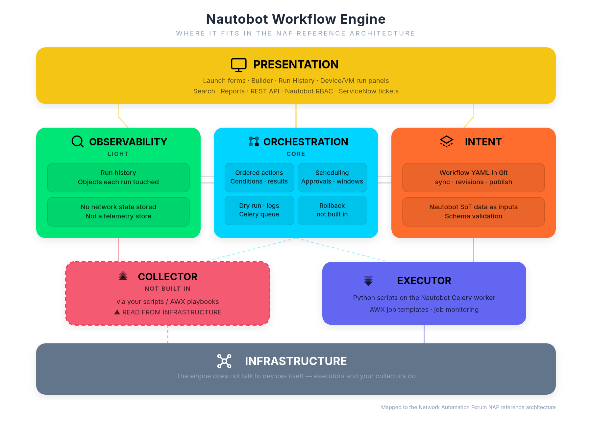
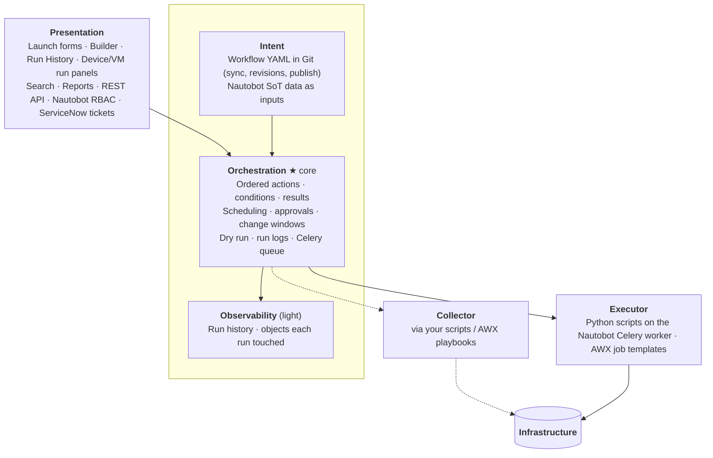

# Nautobot Workflow Engine

Define automation in YAML, synchronize it through Nautobot's repository integration,
and launch it from dynamic forms. Execute Python scripts in Nautobot or job templates
in AWX, with ordered actions, reusable results, scheduling, and run history.

## Capabilities

- Typed inputs, Nautobot object lookups, dependent choices, conditional visibility,
  validation, and tabular CSV input.
- Pre-actions, main actions, and post-actions in definition order.
- Reusable Python helpers and repository-backed Jinja filters.
- Immediate or scheduled runs, including optional ServiceNow change windows.
- Execution logs, AWX job monitoring, reporting, and estimated time savings.

## Where It Fits in NAF

The Workflow Engine is primarily the Orchestration block of the
[NAF reference architecture](https://reference.networkautomation.forum/Framework/Framework/).
It also provides Presentation and Intent features, and it delegates network
writes to executors rather than talking to devices itself.

Mermaid source

| NAF block | What the Workflow Engine provides |
| --- | --- |
| **Presentation** | Launch forms, the visual builder, Run History and the run pages, the Workflow runs panels on device and VM pages, global search, reports with time savings, and the REST API. Login and permissions come from Nautobot's RBAC, and ServiceNow change tickets are the ITSM tie-in. |
| **Intent** | Workflow YAML versioned in Git and synced through Nautobot's Git repository integration (webhooks, revisions, and publishing back to Git), with schema validation. Nautobot's own data (devices, VMs, IPAM) is used as typed inputs. |
| **Orchestration** (core) | Pre, main, and post actions in order, conditions, passing results between steps, immediate or scheduled runs, Nautobot approvals, ServiceNow change-window gates, dry run and preview, and a full run log for traceability. Runs are queued to the Nautobot Celery worker. |
| **Executor** | Python scripts executed on the Nautobot Celery worker (in-process, not sandboxed), and AWX job templates with job monitoring. |
| **Observability** (light) | Run history and the record of which objects each run touched. The engine does not store network state. |
| **Collector** | Not built in. Your scripts or AWX playbooks can collect data from the network. |
| **Infrastructure** | The devices and systems the executors talk to. The engine does not touch this layer itself. |

The NAF Orchestration block also calls for rollback and compensating actions.
The engine does not provide those as a built-in feature.

## Get Started

The current package requires **Nautobot 3.x** and **Python 3.11 through 3.14**. The
selected Nautobot release must also support that Python version. These are package
requirements, not a claim that every combination has been tested.

1. Install from PyPI with `pip install nautobot-workflow-engine`, then follow
   [installation and configuration](https://github.com/eric-fetty/Nautobot_Workflow_Engine/blob/main/docs/admin/install.md).
2. Configure a trusted workflow source and synchronize its Workflow Engine content.
3. Add the [examples repository](https://github.com/eric-fetty/Nautobot-Demo-Workflows) as a trusted workflow source, then run the non-destructive [hostname tutorial](https://github.com/eric-fetty/Nautobot_Workflow_Engine/blob/main/docs/user/app_getting_started.md) or the full [examples tutorial](https://github.com/eric-fetty/Nautobot_Workflow_Engine/blob/develop/docs/user/examples_tutorial.md).
4. Use the [authoring reference](https://github.com/eric-fetty/Nautobot_Workflow_Engine/blob/main/docs/user/app_use_cases.md) to add inputs and actions.

AWX and ServiceNow are optional. Individual workflows may require additional apps,
Python packages, inventory, or service permissions. Examples are starting points for
review and adaptation, not production-ready deployment definitions.

## Documentation

- [Overview](https://github.com/eric-fetty/Nautobot_Workflow_Engine/blob/main/docs/user/app_overview.md) and [documentation home](https://github.com/eric-fetty/Nautobot_Workflow_Engine/blob/main/docs/index.md).
- [Workflow authoring](https://github.com/eric-fetty/Nautobot_Workflow_Engine/blob/main/docs/user/app_use_cases.md) and [custom filters](https://github.com/eric-fetty/Nautobot_Workflow_Engine/blob/main/docs/dev/extending.md).
- [AWX and ServiceNow](https://github.com/eric-fetty/Nautobot_Workflow_Engine/blob/main/docs/user/external_interactions.md).
- [Compatibility](https://github.com/eric-fetty/Nautobot_Workflow_Engine/blob/main/docs/admin/compatibility_matrix.md), [upgrades](https://github.com/eric-fetty/Nautobot_Workflow_Engine/blob/main/docs/admin/upgrade.md),
  and [release notes](https://github.com/eric-fetty/Nautobot_Workflow_Engine/blob/main/docs/admin/release_notes/index.md).
- [Security and data handling](https://github.com/eric-fetty/Nautobot_Workflow_Engine/blob/main/docs/admin/security.md).

## Examples

The canonical examples live in [Nautobot-Demo-Workflows](https://github.com/eric-fetty/Nautobot-Demo-Workflows).
They are a ladder of ten workflows, from echoing a hostname to a maintenance-window
change, with a lab seed so you can follow along on a lab Nautobot without real
devices or AWX. The first five examples never change inventory. Later examples have
an optional apply switch that defaults to off.

Add that repository as a trusted workflow source, then follow the
[examples tutorial](https://github.com/eric-fetty/Nautobot_Workflow_Engine/blob/develop/docs/user/examples_tutorial.md).

## Trust and Execution Logs

Workflow scripts and filters are trusted code running inside Nautobot, not sandboxed
submissions. Limit who can modify their source and who can launch or inspect runs.
Detailed script execution logging is intentional. Treat inputs, results, output,
diagnostics, and backups as operational data; do not submit or print credentials.

## Contributing

Read the [contribution guide](https://github.com/eric-fetty/Nautobot_Workflow_Engine/blob/main/docs/dev/contributing.md),
[development environment guide](https://github.com/eric-fetty/Nautobot_Workflow_Engine/blob/main/docs/dev/dev_environment.md), and
[architecture overview](https://github.com/eric-fetty/Nautobot_Workflow_Engine/blob/main/docs/dev/arch_decision.md). Keep changes focused, use synthetic
fixtures, preserve migrations, and include regression coverage for behavioral changes.

## Publication Status

This project is licensed under the [Apache License 2.0](https://github.com/eric-fetty/Nautobot_Workflow_Engine/blob/main/LICENSE). Open-source
preparation is otherwise in progress. A private vulnerability-reporting contact and
final artifact validation are still required before public release.