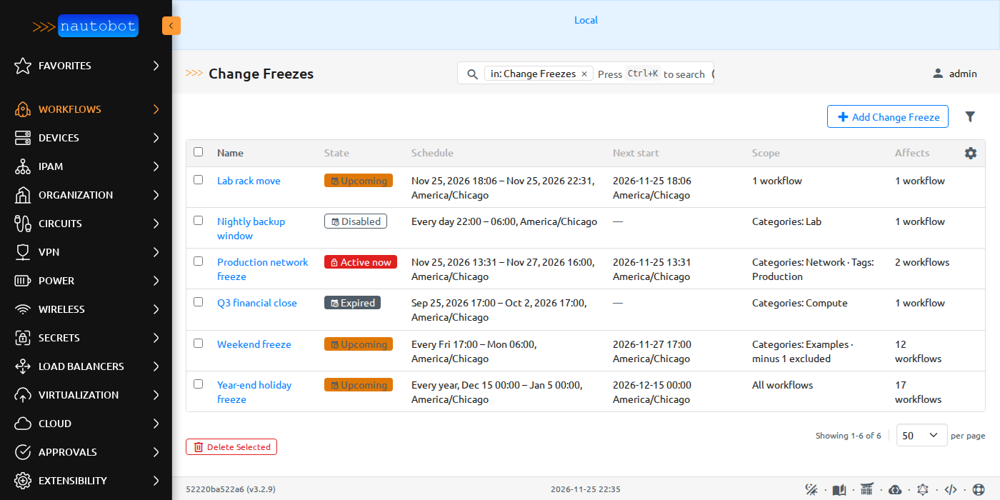
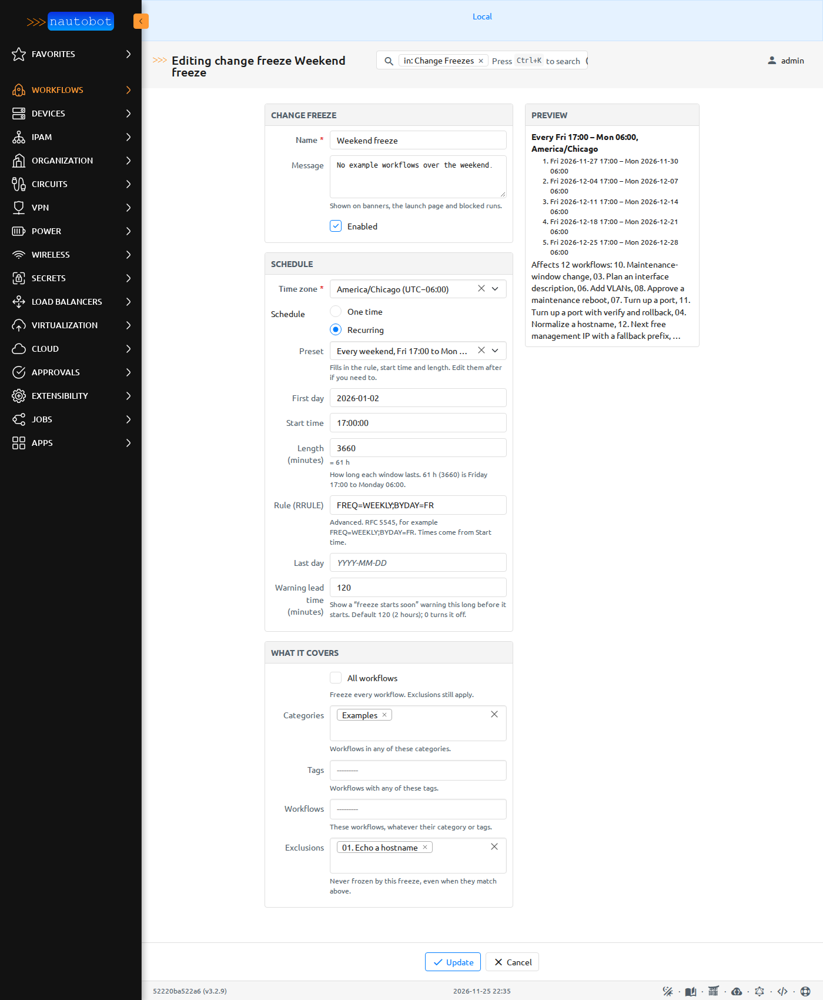
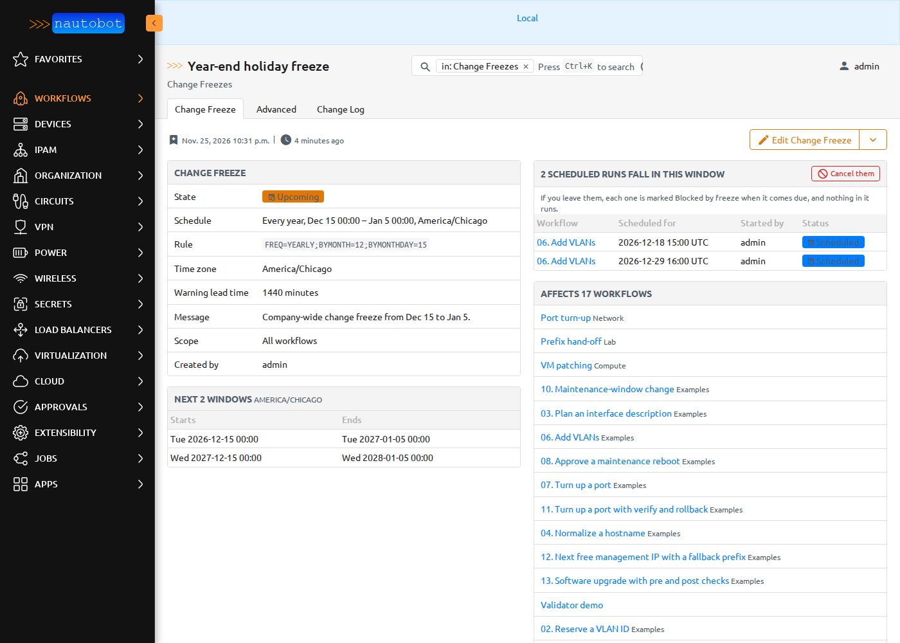

# Change Freezes

A change freeze is a time when no workflow runs: a holiday freeze, a weekend, the nightly
backup window, month-end close. While a freeze covers a workflow, nothing in it starts,
not even the **Before** steps of a scheduled run, because there is no telling what an
action might change.

Open **Workflows → Change Freezes** to see, add and edit freezes. Seeing the list needs
**Workflow Engine: View change freezes**; adding, editing and deleting needs **Workflow
Engine: Manage change freezes**. See [Permissions](../user/permissions.md#change-freezes).



Each row shows the freeze's state, a plain-language schedule, when it next starts, what it
covers and how many workflows that is today:

| State | Meaning |
| --- | --- |
| Active now | A window is open. Covered workflows can't start or be scheduled. |
| Upcoming | Enabled, and another window is coming. |
| Expired | A one-time freeze that has ended, or a rule with no more windows. |
| Disabled | **Enabled** is off. It blocks nothing and shows no banner. |

Filter the list by state or whether it is enabled, or search by name and message.

## Adding a freeze



- **Name** and **Message**. The message is shown on banners, on the launch page and on
  runs the freeze blocks, so say why and who to ask.
- **Time zone**. Every time on the form is read in this zone, so a freeze at 17:00 in
  America/Chicago stays at 17:00 across daylight saving changes.
- **Schedule**: **One time** with **Starts** and **Ends**, or **Recurring**.
- **Warning lead time (minutes)**. A *Change freeze starts soon* banner appears this long
  before each window. The default is 120 (2 hours). Set 0 to turn the warning off for
  this freeze.

### Recurring freezes

Pick a **Preset** to fill in the rule, the start time and the length, then change them if
you need to:

| Preset | Rule | Start | Length |
| --- | --- | --- | --- |
| Every weekend, Fri 17:00 to Mon 06:00 | `FREQ=WEEKLY;BYDAY=FR` | 17:00 | 61 h |
| Every night, 22:00 to 06:00 | `FREQ=DAILY` | 22:00 | 8 h |
| Last weekend of every month | `FREQ=MONTHLY;BYDAY=-1SA` | 00:00 | 48 h |
| Every year, Dec 15 to Jan 5 | `FREQ=YEARLY;BYMONTH=12;BYMONTHDAY=15` | 00:00 | 21 days |

**Rule (RRULE)** is an [RFC 5545](https://datatracker.ietf.org/doc/html/rfc5545#section-3.3.10)
recurrence rule without `DTSTART`: the first window comes from **First day** and **Start
time**. Rules more often than hourly are refused. **Last day** ends the rule.

Each window lasts **Length (minutes)** of wall-clock time, so the weekend preset always ends
at Monday 06:00, even on the weekend the clocks change. If a start time falls in the hour
skipped when clocks go forward, the window starts when the clock reads that time after the
jump; if it falls in the hour that repeats when clocks go back, the first one is used.

The **Preview** on the right shows the schedule in words, the next five windows in the
freeze's time zone, and **Affects N workflows** with their names. It updates as you type
and saves nothing.

### What it covers

- **All workflows**, or any mix of **Categories**, **Tags** and individual **Workflows**.
  A workflow matching any of them is covered.
- **Exclusions** are never covered by this freeze, even when they match.

There is no per-workflow "exempt from freezes" switch. Use a tag, a category or an
exclusion instead, so the exception is visible on the freeze.

### Runs already scheduled in the window



When you save a freeze, the message says how many Scheduled and Pending Approval runs fall
inside its windows. The freeze page lists them with **Cancel them**. If you leave them, each
one is marked **Blocked by freeze** when it comes due, and nothing in it runs. The page also
lists the workflows it affects, runs it has blocked, and runs that overrode it.

## What a freeze stops

| When | What happens |
| --- | --- |
| **Run now** during a freeze | Refused with the freeze's name and message. No run is created. |
| **Schedule for later** inside a window | Refused. Pick a time outside it. |
| **Schedule for later** while a freeze is active | Refused even if the time is after the freeze, because the **Before** steps would run now. |
| **In the change window** (ServiceNow) | Refused when the change window starts inside a freeze. |
| A scheduled or approved run comes due in a window | The run is set to **Blocked by freeze** instead of starting. It is not canceled, so it stays visible in Run History and on the freeze page. |
| A run already running when the freeze starts | Keeps running. |
| **Preview run** in the builder | Allowed. It never runs anything. |

The check runs when the run is booked and again when it fires, so a freeze added after a run
was scheduled still stops it.

**Blocked by freeze** is left out of the dashboard's success rate, as are canceled
runs. See [Dashboard and time saved](../user/app_reporting.md).

## Banners

Anyone who can see a workflow sees the freezes that cover it, without any freeze
permission: a banner on the **Workflows** list and the launch page while a freeze is active,
and a *starts soon* banner within each freeze's warning lead time. A covered workflow shows a
lock badge on the Workflows list, and its **Run** button is off for people who can't
override. See [During a change freeze](../user/launch.md#during-a-change-freeze).

## Overriding a freeze

People with **Workflow Engine: Override change freezes** can still run a covered workflow.
The launch page asks for an **Override reason**, which is required; the button reads
**Override and run**. The reason and who gave it are stored on the run and in its log, and
shown on the run page and on the freeze page.

A scheduled run booked with an override only counts if the person who booked it still holds
the permission when it fires. Otherwise it is blocked like any other run.

A constraint on the permission, such as `{"category": "Networking"}`, limits which workflows
someone can override.

## Edits that would leave a freeze

Taking a workflow out of an active or upcoming freeze is the same as overriding it, so it
needs **Override change freezes** too:

- removing a tag that the freeze matches, in the builder, the API or **Bulk edit tags**;
- changing the category, when saving a draft or publishing.

The builder and the API refuse the save with the freeze's name. **Bulk edit tags** skips
those workflows and says how many were skipped and why. A Git sync that would change the
category of such a workflow leaves it as it is and logs `E-NWE-302` with the freeze's name;
a later sync applies it once no freeze covers the workflow.

Adding tags, or a change that keeps the workflow covered, needs nothing extra.

## REST API

| Endpoint | What it does |
| --- | --- |
| `GET/POST /api/plugins/workflow-engine/change-freezes/` | List and create freezes. |
| `GET/PATCH/PUT/DELETE /api/plugins/workflow-engine/change-freezes/<id>/` | Read, edit and delete one. |
| `GET /api/plugins/workflow-engine/change-freezes/status/?workflow=<key>&at=<ISO time>` | Whether that workflow (or any, without `workflow`) is frozen at that time (default now), which freezes, and the next one. |
| `POST /api/plugins/workflow-engine/change-freezes/preview/` | Takes the same fields as create and returns the schedule in words, the next windows, the affected workflows and the scheduled runs inside. Saves nothing. |

The freeze endpoints use the view, add, change and delete change freeze permissions. The
status endpoint only answers for workflows the caller can see. Each freeze in the API
includes its computed `state` and `schedule`.

Example: a weekend freeze for Networking.

```json
{
  "name": "Weekend freeze",
  "message": "No network changes at the weekend. Ask #netops for an override.",
  "timezone": "America/Chicago",
  "kind": "recurring",
  "rrule": "FREQ=WEEKLY;BYDAY=FR",
  "recur_start_date": "2026-01-02",
  "recur_start_time": "17:00",
  "duration_minutes": 3660,
  "warning_lead_minutes": 120,
  "categories": ["Networking"]
}
```
