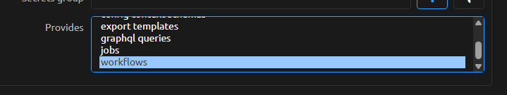

# Installing the App in Nautobot

Here you will find detailed instructions on how to **install** and **configure** the App within your Nautobot environment.

## Prerequisites

- Nautobot 3.x with a Python version supported by both Nautobot and this app.
- Working Nautobot background workers and scheduling services.
- A supported Nautobot database and access to a trusted workflow source.
- Permission to configure apps, repository synchronization, and any optional integrations.

See [compatibility](compatibility_matrix.md) for the package version requirements.
Workflow-specific apps and Python dependencies must be available to the workers as
well as the web application. AWX and ServiceNow are optional.

## Install Guide

!!! note
    Apps can be installed from the Python Package Index or locally. See the Nautobot
    [app installation guide](https://docs.nautobot.com/projects/core/en/stable/user-guide/administration/installation/app-install/)
    for more details. The pip package name for this app is
    [`nautobot-workflow-engine`](https://pypi.org/project/nautobot-workflow-engine/).

The app is available as a Python package via PyPI and can be installed with `pip`:

```no-highlight
pip install nautobot-workflow-engine
```

To ensure the app is automatically re-installed during future upgrades, create a file
named `local_requirements.txt` (if not already existing) in the Nautobot root directory
(alongside `requirements.txt`) and list the package:

```no-highlight
echo nautobot-workflow-engine >> local_requirements.txt
```

Once installed, enable the app in your Nautobot configuration. Add
`nautobot_workflow_engine` to the existing `PLUGINS` list:

```python
PLUGINS = [
    "nautobot_workflow_engine",
]
```

Once the Nautobot configuration is updated, run the Post Upgrade command to run
migrations and clear any cache:

```no-highlight
nautobot-server post_upgrade
```

Then restart (if necessary) the Nautobot services which may include Nautobot, Nautobot
Workers, and Nautobot Scheduler:

```no-highlight
sudo systemctl restart nautobot nautobot-worker nautobot-scheduler
```

Apply the same package and `PLUGINS` entry to the web application, workers, and
scheduler before synchronizing workflows.

## Configure the App

Staff and superuser accounts can manage all app settings from the UI:

1. Open **Apps → Installed Apps** (or **Extensibility → Installed Apps**, depending on
   your Nautobot navigation).
2. Find **Workflow Engine** and click the gear (**Configure**) icon.
3. Update the settings and click **Update Configuration**.

Defaults apply until you change them. Credentials for AWX and ServiceNow remain on
Nautobot External Integrations and Secrets Groups; they are not stored in app
settings.

## Configuration Reference

| Setting | Default | Purpose |
| --- | --- | --- |
| `workflow_dir` | `workflows` | Directory containing workflow YAML in the workflow source. |
| `filters_dir` | `filters` | Directory containing repository-backed Jinja filters. |
| `awx_external_integration_name` | `AWX` | Nautobot External Integration used for AWX actions. |
| `awx_poll_seconds` | `5` | Polling interval in seconds for AWX job monitoring. |
| `show_disabled` | `False` | Display disabled workflows in the workflow list. |
| `show_add_new_item` | `[]` | Object types (`app_label.model`) that offer the create-new-item choice on object inputs. Select them in the configuration UI multi-select. |

The create-new-item choice passes `__create__` to the workflow. Its action code must
handle that value; choosing it does not create an object automatically.

### Optional file overrides

You may still set any of the keys above under `PLUGINS_CONFIG` in
`nautobot_config.py`. A key present in the file **overrides** the UI value and locks
that field on the configuration page until you remove it from the file:

```python
PLUGINS_CONFIG = {
    "nautobot_workflow_engine": {
        # Example: force a poll interval at deploy time
        "awx_poll_seconds": 5,
    },
}
```

Omit keys (or leave `PLUGINS_CONFIG["nautobot_workflow_engine"]` empty) to manage them
from the Installed Apps configuration page.

## Configure Workflow Content

Configure a Nautobot Git Repository for a trusted workflow source and select its
Workflow Engine content. YAML lives under `workflow_dir`, action scripts under
their declared paths, and reusable helpers conventionally under `scripts/lib/`.
Synchronize the source and inspect the synchronization result before launching runs.



### Optional: Nautobot approval for workflows (3.2+)

Workflows may set `approval_required: true` in YAML. On Nautobot 3.2+, git sync creates
a scoped Approval Workflow Definition named `Workflow Engine: <workflow.key>`. After
sync, open **Approvals → Workflow Definitions** and add one or more stages (approver
group and minimum approvers). Until stages exist, approval-gated runs remain pending.
See [Requiring Nautobot Approval](../user/app_use_cases.md#requiring-nautobot-approval-32)
in the authoring reference.

Start with the [hostname tutorial](../user/app_getting_started.md). Configure
[AWX or ServiceNow](../user/external_interactions.md) only when a workflow requires it.
Use HTTPS and verified certificates for remote services.

## Jobs Installed by the App

After you run `nautobot-server post_upgrade`, Nautobot creates Job records for
this app. Nautobot starts most app jobs **disabled**. This app then turns on the
two jobs it needs so scheduled and approval-gated runs work without extra clicks.

### What the app enables for you

These two jobs are **enabled automatically** on every `post_upgrade` (and whenever
the database-ready signal runs for this app):

| Job | Visible | Enabled by default? | Purpose |
| --- | --- | --- | --- |
| Execute Scheduled Workflow | Hidden | **Yes** (app turns it on) | Runs a pre-created workflow run at its scheduled time. Required for deferred, approval-gated, and ServiceNow-scheduled runs. |
| Clean Orphaned Workflow Runs | Hidden | **Yes** (app turns it on) | Deletes workflow runs stuck in **Scheduled** or **Pending** with no matching scheduled job. |

You do **not** need to find or enable these jobs in the UI for basic scheduling to
work. They are hidden on purpose because the engine triggers them; you still do
not need to un-hide them just to keep them enabled.

!!! warning
    Do **not** disable **Execute Scheduled Workflow** or **Clean Orphaned Workflow
    Runs** in **Jobs → Jobs**. If the executor is disabled, Nautobot will refuse to
    create or run scheduled workflow jobs, and deferred / approval / ServiceNow
    schedules will fail. If you disable them by mistake, run
    `nautobot-server post_upgrade` again; the app will turn them back on.

### What you must enable yourself (ServiceNow only)

| Job | Visible | Enabled by default? | Purpose |
| --- | --- | --- | --- |
| Sync ServiceNow Scheduled Workflows | Visible | **No — you enable it** | Revalidates scheduled ServiceNow-backed runs against their change tickets. |

If you schedule workflows from ServiceNow change windows, you must enable this job
and create a recurring schedule yourself. Step-by-step clicks:

[Keeping Scheduled Runs in Sync with ServiceNow](../user/external_interactions.md#keeping-scheduled-runs-in-sync-with-servicenow)

If you do not use ServiceNow scheduling, you can ignore that job.

### Cleaning Up Orphaned Workflow Runs

A run becomes orphaned when it is left in **Scheduled** or **Pending** but has no
scheduled job to execute it, for example after the underlying scheduled job is
removed. Orphaned runs block normal operations and clutter run history. The
**Clean Orphaned Workflow Runs** job deletes those orphaned records so history
reflects only live runs.

The app already **enables** this job. You can run it once from the UI when you
need a cleanup, or optionally schedule it to run periodically:

1. Open **Jobs → Jobs**.
2. Turn on the filter or option that shows **hidden** jobs (this job is hidden).
3. Open **Clean Orphaned Workflow Runs**.
4. Run it now, **or** create a **Scheduled Job** (for example daily) if you expect
   stuck runs often.


It deletes only runs that have no corresponding scheduled job; runs with a live
scheduled job are left untouched.

!!! warning
    This job deletes workflow run records. Review its logs after the first runs
    and schedule it at a cadence that matches your operational expectations.

## Permissions

| Permission | Level | Purpose |
| --- | --- | --- |
| `nautobot_workflow_engine.view_workflow` | Object | Browse (and launch) specific workflows. |
| `nautobot_workflow_engine.add_workflowrun` | Model | Grant the ability to launch runs at all. |
| `nautobot_workflow_engine.view_workflowrun` | Object | View specific run records and their reports. |
| `nautobot_workflow_engine.change_workflowrun` | Object | Cancel a specific run while it is scheduled. |

`view_workflow`, `view_workflowrun`, and `change_workflowrun` are **object-level**
permissions: use a Nautobot object permission with a constraint to scope them to a
subset of objects. `add_workflowrun` is a **model-level** capability: a user who
holds it for any workflow can launch runs, so pair it with a scoped
`view_workflow` to control *which* workflows they may actually run.

### Scoping by Name, Category, or Entirely

The same permission can be granted broadly or narrowly. The scope is set by the
object permission's **constraint** (a JSON filter over the model's fields).

- **Entirely** — no constraint (the permission applies to all objects).
- **By category** — `{"category": "Networking"}` on the **Workflow** model, or
  `{"workflow__category": "Networking"}` on the **WorkflowRun** model.
- **By name** — `{"name": "Echo Hostname"}` on the **Workflow** model, or
  `{"workflow__name": "Echo Hostname"}` on the **WorkflowRun** model.

Constraints use the field names of the model being authorized. A Workflow
constraint such as `{"category": "Networking"}` does **not** apply to WorkflowRun
objects; for runs, reference the related workflow with `workflow__category` or
`workflow__name`.

### Example: A Team That Runs Only One Category

Grant the **Networking** team access to launch workflows in the
`Networking` category and nothing else:

1. Create a Nautobot group, e.g. `networking-operators`.
2. Grant the group `add_workflowrun` (model permission, no constraint).
3. Create an object permission for `view_workflow` with the constraint
   `{"category": "Networking"}` and assign it to the group.

Members of the group now see only `Networking` workflows and can launch only those.
The model-level `add_workflowrun` gives them the ability to launch; the constrained
`view_workflow` limits the scope to their category.

### Example: A Manager Who Reads Only Their Team's Reports

Grant a manager read access to the run records (and the reporting dashboard) for the
workflows their team can run, without giving them access to other teams' data:

1. Create (or reuse) a Nautobot group, e.g. `networking-operators`.
2. Create an object permission for `view_workflowrun` with the constraint
   `{"workflow__category": "Networking"}` and assign it to the manager (or the
   group).

The reporting dashboard is built from the runs the viewer is allowed to see. The
view is filtered to the WorkflowRun objects the user has `view_workflowrun`
permission for, so a manager constrained to `workflow__category = Networking` sees
only that category's runs in run history, status summaries, success rates, and
time-savings figures. Runs outside the constraint are excluded from every report.

To also let the manager *run* the workflows (not just view reports), add
`add_workflowrun` (model) and a constrained `view_workflow`
(`{"category": "Networking"}`) as in the previous example.

### Verifying and Revising

Assign object permissions through Nautobot and verify visibility using
representative accounts before widening access. When a team's scope changes,
update the constraint on the existing object permission rather than creating a
new one, and re-check both the workflow list and the reporting dashboard.


See [security and data handling](security.md) before granting access to
operational workflows.
