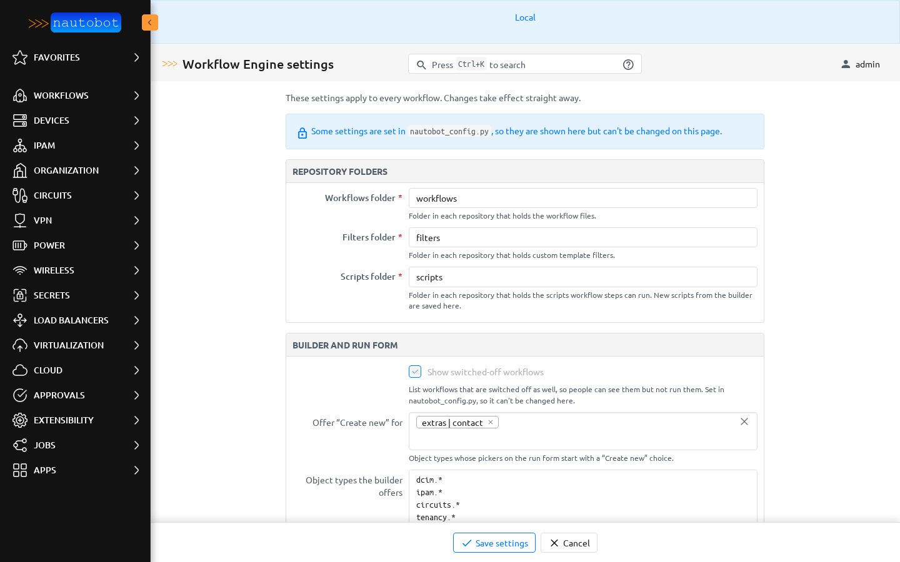
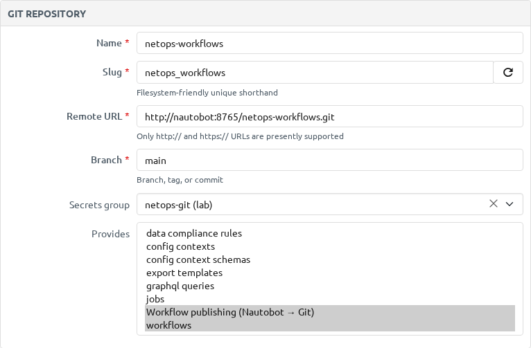
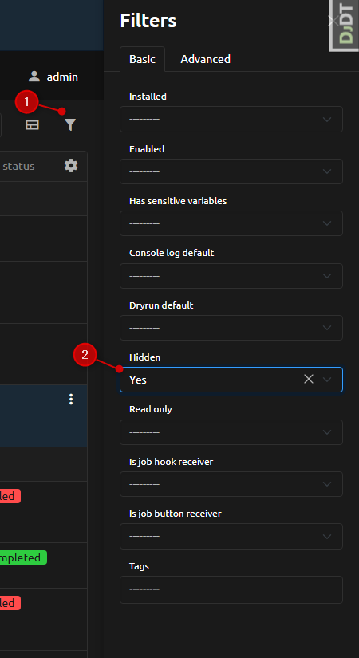
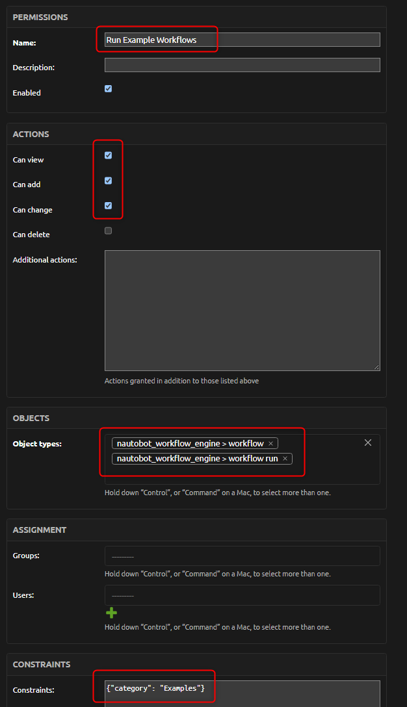

# Installing the App in Nautobot

Here you will find detailed instructions on how to **install** and **configure** the App within your Nautobot environment.

## Prerequisites

- Nautobot 3.x with a Python version supported by both Nautobot and this app.
- Working Nautobot background workers and scheduling services.
- A supported Nautobot database and access to a trusted workflow source.
- Permission to configure apps, repository synchronization, and any optional integrations.

See [compatibility](compatibility_matrix.md) for the package version requirements.
Workflow-specific apps and Python dependencies must be available to the workers as
well as the web application. AWX and ServiceNow are optional.

## Install Guide

!!! note
    Apps can be installed from the Python Package Index or locally. See the Nautobot
    [app installation guide](https://docs.nautobot.com/projects/core/en/stable/user-guide/administration/installation/app-install/)
    for more details. The pip package name for this app is
    [`nautobot-workflow-engine`](https://pypi.org/project/nautobot-workflow-engine/).

The app is available as a Python package via PyPI and can be installed with `pip`:

```no-highlight
pip install nautobot-workflow-engine
```

To ensure the app is automatically re-installed during future upgrades, create a file
named `local_requirements.txt` (if not already existing) in the Nautobot root directory
(alongside `requirements.txt`) and list the package:

```no-highlight
echo nautobot-workflow-engine >> local_requirements.txt
```

Once installed, enable the app in your Nautobot configuration by adding
`nautobot_workflow_engine` to the existing `PLUGINS` list. No `PLUGINS_CONFIG` entry is
needed: every setting has a sensible default and can be changed later on the app's
[Settings page](#settings-page).

```python
PLUGINS = [
    "nautobot_workflow_engine",
]
```

Once the Nautobot configuration is updated, run the Post Upgrade command to run
migrations and clear any cache:

```no-highlight
nautobot-server post_upgrade
```

Then restart (if necessary) the Nautobot services which may include Nautobot, Nautobot
Workers, and Nautobot Scheduler:

```no-highlight
sudo systemctl restart nautobot nautobot-worker nautobot-scheduler
```

Apply the same package and `PLUGINS` entry to the web application, workers, and
scheduler before synchronizing workflows.

## Settings Page

Open **Apps → Installed Apps** and choose the gear icon next to **Workflow Engine**
(or go to `/plugins/workflow-engine/settings/`). The page is for Nautobot
administrators (superusers) and shows every setting, grouped as **Repository folders**,
**Builder and run form**, **Publishing to Git** and **AWX**. Choose **Save settings**;
changes take effect straight away on the web servers and workers, with no restart.



Changing **Check repositories every (minutes)** also updates the
*Workflow Engine Git sync* schedule.

A setting can still be pinned in `nautobot_config.py` instead, for example to keep it
the same across environments. A key set there wins, and the Settings page shows it
greyed out with *Set in nautobot_config.py, so it can't be changed here.* Remove the key
from the file to manage it on the page again.

```python
PLUGINS_CONFIG = {
    "nautobot_workflow_engine": {
        "scripts_dir": "automation/scripts",  # locked on the Settings page
    },
}
```

Upgrading from a version that used `PLUGINS_CONFIG` needs nothing: keys that are still in
the file keep working and show as locked. To move one to the page, note its value,
remove it from the file, restart, and enter it on the page.

Credentials for AWX and ServiceNow stay on Nautobot External Integrations and Secrets
Groups; they are not app settings.

## Configuration Reference

| Setting (on the page) | Key | Default | Purpose |
| --- | --- | --- | --- |
| Workflows folder | `workflow_dir` | `workflows` | Folder in each repository that holds the workflow files. |
| Filters folder | `filters_dir` | `filters` | Folder in each repository that holds custom template filters. |
| Scripts folder | `scripts_dir` | `scripts` | Folder that workflow steps may run scripts from. **New script…** in the builder writes new scripts here. |
| Show switched-off workflows | `show_disabled` | Off | List switched-off workflows as well. |
| Offer “Create new” for | `show_add_new_item` | Environment-derived | Object types whose pickers on the run form start with a “Create new” choice. Defaults to `SHOW_ADD_NEW_ITEM` until set. |
| Object types the builder offers | `builder_model_allowlist` | `dcim.*`, `ipam.*`, `circuits.*`, `tenancy.*`, `virtualization.*`, `cloud.*`, `wireless.*`, `vpn.*`, `load_balancers.*`, and a few `extras` models | One per line, `app.model` or `app.*`. Empty means the default set. |
| Committer name | `git_committer_name` | `Nautobot Workflow Engine` | Committer name on publish commits. The author is the person who published. |
| Committer email | `git_committer_email` | `nautobot-workflow-engine@localhost` | Committer email on publish commits. |
| Author email domain | `git_author_email_domain` | `users.noreply.nautobot.local` | Domain for the author email of a user who has no email address. |
| Check repositories every (minutes) | `git_sync_interval_minutes` | `5` | How often **Workflow Git Maintenance** checks repositories and retries failed pushes. |
| Give up reaching a repository after (seconds) | `git_remote_timeout_seconds` | `10` | Timeout for the Git check the builder does when it opens. |
| Longest a publish may take (seconds) | `git_push_lock_timeout` | `300` | Seconds one publish may hold a repository before another can start. |
| Retry a waiting publish after (minutes) | `git_push_retry_backoff_minutes` | `1, 5, 15, 60` | Wait before each automatic retry of a failed push. The last value repeats. |
| AWX connection | `awx_external_integration_name` | `AWX` | Nautobot External Integration used for AWX actions. |
| Check AWX jobs every (seconds) | `awx_poll_seconds` | `5` | Polling interval for AWX job monitoring. |

The create-new-item choice passes `__create__` to the workflow. Its action code must
handle that value; choosing it does not create an object automatically.

## Configure Workflow Content

Configure a Nautobot Git Repository for a trusted workflow source and select its
Workflow Engine content. YAML lives under `workflow_dir`, action scripts under
`scripts_dir`, and reusable helpers conventionally under `scripts/lib/`.
Synchronize the source and inspect the synchronization result before launching runs.

### Publishing from the builder to Git

To let the builder publish workflows (and create new scripts) in a repository:

1. Give the repository a **secrets group** with a secret of access type **HTTP(S)** and
   secret type **Token**. A token on its own works. Add an **HTTP(S)** / **Username**
   secret too if the Git server needs a username. These are the same credentials
   Nautobot core and the Golden Config app use for repositories.
2. Under **Provides**, tick **workflows**. Any repository that provides workflows and has
   a token can be published to; there is no separate publishing option.
3. Use an `https://` remote URL, and give the token's account push access to the
   repository's branch. Check branch protection rules.
4. Sync the repository.



If something is missing, the builder tells editors exactly what, and **Publish changes**
stays off. Every publish error and its fix is listed in
[When publishing fails](../user/publishing.md#when-publishing-fails). The full error, with
the token removed, is written to the Nautobot server log and to the log of the
**Publish Workflows to Git** job.

### Scripts created in the builder

People with the **Write scripts** permission can commit a new script from the builder
(see [New scripts from the builder](../user/placeholder_scripts.md)). The builder only
parses the code; it never imports or runs it. Each file is committed under
`scripts_dir` as a starter that prints each value it receives. It needs no extra flag
and runs like any other script once a workflow step uses it, so review it like any
other code change.

### Optional: Nautobot approval for workflows (3.2+)

Workflows may set `approval_required: true` in YAML. On Nautobot 3.2+, git sync creates
a scoped Approval Workflow Definition named `Workflow Engine: <workflow.key>`. After
sync, open **Approvals → Workflow Definitions** and add one or more stages (approver
group and minimum approvers). Until stages exist, approval-gated runs remain pending.
See [Requiring Nautobot Approval](../user/app_use_cases.md#requiring-nautobot-approval-32)
in the authoring reference.

Start with the [hostname tutorial](../user/app_getting_started.md). Configure
[AWX or ServiceNow](../user/external_interactions.md) only when a workflow requires it.
Use HTTPS and verified certificates for remote services.

## Jobs Installed by the App

After you run `nautobot-server post_upgrade`, Nautobot creates Job records for
this app. Nautobot starts most app jobs **disabled**. This app then turns on the
jobs it needs so scheduled runs, approval-gated runs and Git publishing work without
extra clicks.

### What the app enables for you

These jobs are **enabled automatically** on every `post_upgrade` (and whenever
the database-ready signal runs for this app):

| Job | Visible | Enabled by default? | Purpose |
| --- | --- | --- | --- |
| Execute Scheduled Workflow | Hidden | **Yes** (app turns it on) | Runs a pre-created workflow run at its scheduled time. Required for deferred, approval-gated, and ServiceNow-scheduled runs. |
| Clean Orphaned Workflow Runs | Hidden | **Yes** (app turns it on) | Deletes workflow runs stuck in **Scheduled** or **Pending** with no matching scheduled job. |
| Publish Workflows to Git | Hidden | **Yes** (app turns it on) | Pushes published workflows and builder-created scripts to their repository. Its log has the full error when a push fails. |
| Workflow Git Maintenance | Hidden | **Yes** (app turns it on and schedules it every `git_sync_interval_minutes`) | Syncs repositories that changed in Git and retries failed pushes. |

You do **not** need to find or enable these jobs in the UI for basic scheduling to
work. They are hidden on purpose because the engine triggers them; you still do
not need to un-hide them just to keep them enabled.

!!! warning
    Do **not** disable **Execute Scheduled Workflow** or **Clean Orphaned Workflow
    Runs** in **Jobs → Jobs**. If the executor is disabled, Nautobot will refuse to
    create or run scheduled workflow jobs, and deferred / approval / ServiceNow
    schedules will fail. If you disable them by mistake, run
    `nautobot-server post_upgrade` again; the app will turn them back on.

### What you must enable yourself (ServiceNow only)

| Job | Visible | Enabled by default? | Purpose |
| --- | --- | --- | --- |
| Sync ServiceNow Scheduled Workflows | Visible | **No — you enable it** | Revalidates scheduled ServiceNow-backed runs against their change tickets. |

If you schedule workflows from ServiceNow change windows, you must enable this job
and create a recurring schedule yourself. Step-by-step clicks:

[Keeping Scheduled Runs in Sync with ServiceNow](../user/external_interactions.md#keeping-scheduled-runs-in-sync-with-servicenow)

If you do not use ServiceNow scheduling, you can ignore that job.

### Cleaning Up Orphaned Workflow Runs

A run becomes orphaned when it is left in **Scheduled** or **Pending** but has no
scheduled job to execute it, for example after the underlying scheduled job is
removed. Orphaned runs block normal operations and clutter run history. The
**Clean Orphaned Workflow Runs** job deletes those orphaned records so history
reflects only live runs.

The app already **enables** this job. You can run it once from the UI when you
need a cleanup, or optionally schedule it to run periodically:

1. Open **Jobs → Jobs**.
2. Turn on the filter or option that shows **hidden** jobs (this job is hidden).
3. Open **Clean Orphaned Workflow Runs**.
4. Run it now, **or** create a **Scheduled Job** (for example daily) if you expect
   stuck runs often.



It deletes only runs that have no corresponding scheduled job; runs with a live
scheduled job are left untouched.

!!! warning
    This job deletes workflow run records. Review its logs after the first runs
    and schedule it at a cadence that matches your operational expectations.

## Permissions

| Permission | Level | Purpose |
| --- | --- | --- |
| `nautobot_workflow_engine.view_workflow` | Object | Browse (and launch) specific workflows. |
| `nautobot_workflow_engine.add_workflowrun` | Model | Grant the ability to launch runs at all. |
| `nautobot_workflow_engine.view_workflowrun` | Object | View specific run records and their reports. |
| `nautobot_workflow_engine.change_workflowrun` | Object | Cancel a specific run while it is scheduled. |
| `nautobot_workflow_engine.add_workflow` | Object | Create workflows in the builder. |
| `nautobot_workflow_engine.change_workflow` | Object | Edit drafts (templates, conditions, script choices and the YAML view included) and use Preview run. |
| `nautobot_workflow_engine.publish_workflow` | Object | Publish, switch Enabled, retry a push. Additional action `publish`. |
| `nautobot_workflow_engine.write_script_workflow` | Object | Create scripts from the builder. Additional action `write_script`. |

The last two are custom actions on the **nautobot_workflow_engine | workflow** object
type. What each one allows in the builder is described in
[Permissions](../user/permissions.md).

### Ready-made permissions

`nautobot-server post_upgrade` (or `migrate`) creates one object permission per role,
named **Workflow Engine: View workflows**, **Run workflows**, **View runs**,
**Cancel runs**, **Build workflows**, **Publish workflows** and **Write scripts**, each with
the right object type, actions and a description. They are assigned to nobody, so
installing the app gives nobody new access. Open **Admin → Users → Permissions**, pick
one, and add users or groups.

A permission is only created when none with that name exists, so your edits, constraints
and assignments survive every upgrade. Deleting one brings it back, unassigned, on the
next upgrade; rename it to retire it.

There is no approve permission. Approvers are the approver groups on the stages in
**Approvals → Workflow Definitions**; the app never checks a permission for approving.

Earlier builds also created **Workflow Engine: Author templates and scripts** (now part
of **Build workflows**) and **Workflow Engine: Approve runs**. The upgrade deletes each
one only if it still has its original description, actions and object types, no
constraints, and no users or groups. Otherwise it stays, grants nothing the app checks,
and the upgrade logs a warning naming it; delete it yourself when you're ready.

`view_workflow`, `view_workflowrun`, and `change_workflowrun` are **object-level**
permissions: use a Nautobot object permission with a constraint to scope them to a
subset of objects. `add_workflowrun` is a **model-level** capability: a user who
holds it for any workflow can launch runs, so pair it with a scoped
`view_workflow` to control *which* workflows they may actually run.

### Scoping by Name, Category, or Entirely

The same permission can be granted broadly or narrowly. The scope is set by the
object permission's **constraint** (a JSON filter over the model's fields).

- **Entirely** — no constraint (the permission applies to all objects).
- **By category** — `{"category": "Networking"}` on the **Workflow** model, or
  `{"workflow__category": "Networking"}` on the **WorkflowRun** model.
- **By name** — `{"name": "Echo Hostname"}` on the **Workflow** model, or
  `{"workflow__name": "Echo Hostname"}` on the **WorkflowRun** model.

Constraints use the field names of the model being authorized. A Workflow
constraint such as `{"category": "Networking"}` does **not** apply to WorkflowRun
objects; for runs, reference the related workflow with `workflow__category` or
`workflow__name`.

### Example: A Team That Runs Only One Category

Grant the **Networking** team access to launch workflows in the
`Networking` category and nothing else:

1. Create a Nautobot group, e.g. `networking-operators`.
2. Grant the group `add_workflowrun` (model permission, no constraint).
3. Create an object permission for `view_workflow` with the constraint
   `{"category": "Networking"}` and assign it to the group.

Members of the group now see only `Networking` workflows and can launch only those.
The model-level `add_workflowrun` gives them the ability to launch; the constrained
`view_workflow` limits the scope to their category.

### Example: A Manager Who Reads Only Their Team's Reports

Grant a manager read access to the run records (and the reporting dashboard) for the
workflows their team can run, without giving them access to other teams' data:

1. Create (or reuse) a Nautobot group, e.g. `networking-operators`.
2. Create an object permission for `view_workflowrun` with the constraint
   `{"workflow__category": "Networking"}` and assign it to the manager (or the
   group).

The reporting dashboard is built from the runs the viewer is allowed to see. The
view is filtered to the WorkflowRun objects the user has `view_workflowrun`
permission for, so a manager constrained to `workflow__category = Networking` sees
only that category's runs in run history, status summaries, success rates, and
time-savings figures. Runs outside the constraint are excluded from every report.

To also let the manager *run* the workflows (not just view reports), add
`add_workflowrun` (model) and a constrained `view_workflow`
(`{"category": "Networking"}`) as in the previous example.

### Verifying and Revising

Assign object permissions through Nautobot and verify visibility using
representative accounts before widening access. When a team's scope changes,
update the constraint on the existing object permission rather than creating a
new one, and re-check both the workflow list and the reporting dashboard.



See [security and data handling](security.md) before granting access to
operational workflows.
