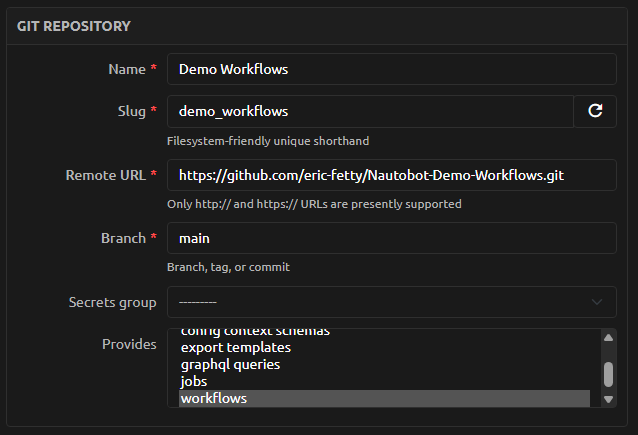
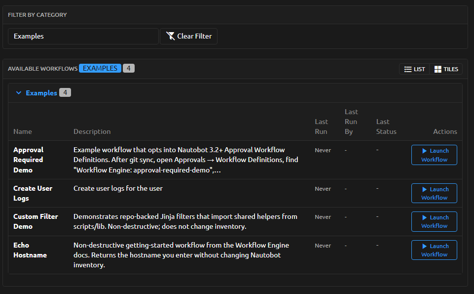
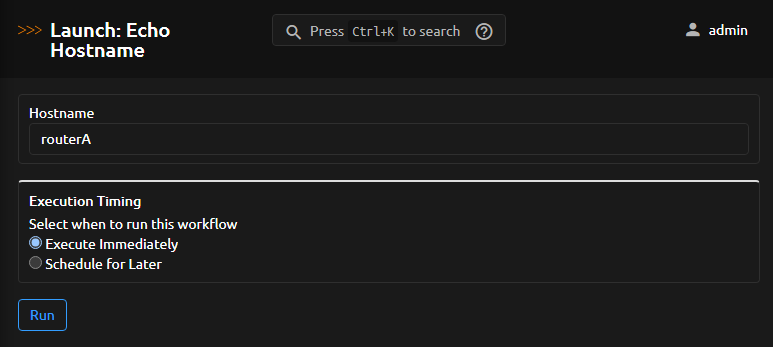
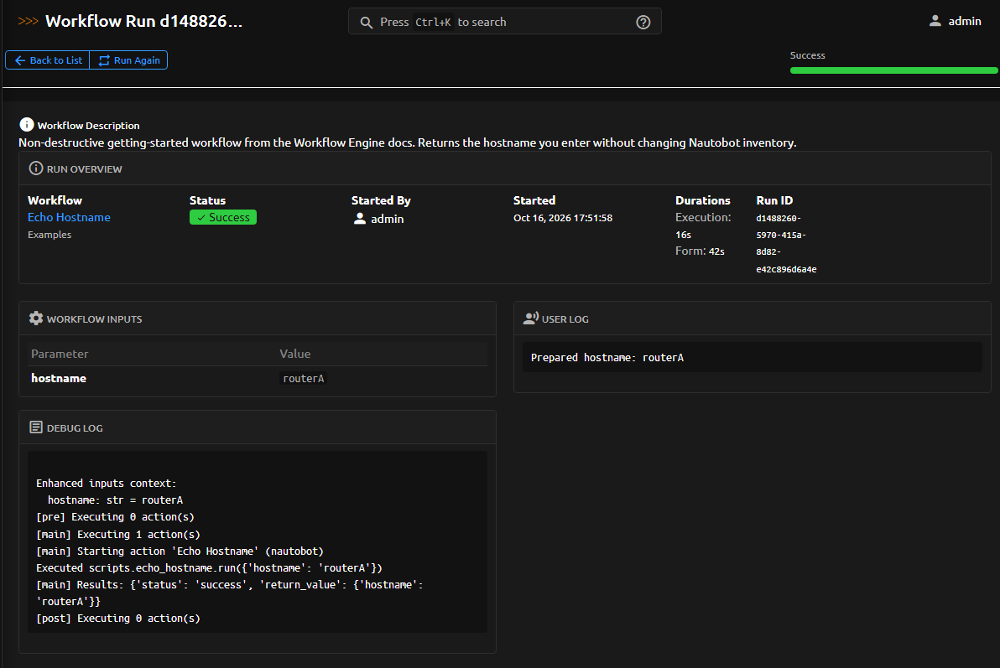
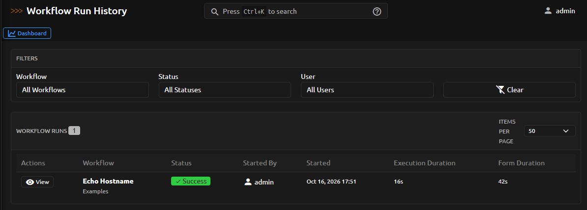
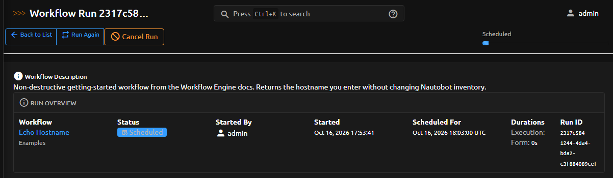

# Getting Started with the App

This example returns a hostname without changing Nautobot inventory or calling an
external service. Complete [installation](../admin/install.md) first and ensure the
Nautobot background workers are running. Installation auto-enables the jobs required
for scheduled runs; if you use ServiceNow change-window scheduling, you must still
[enable and schedule the ServiceNow sync job](external_interactions.md#keeping-scheduled-runs-in-sync-with-servicenow)
yourself.

## Define a Workflow

In a trusted workflow source, use the following layout:

```text
workflows/
    echo-hostname.yaml
scripts/
    echo_hostname.py
```

The workflow definition is:

```yaml
key: echo-hostname
name: Echo Hostname
category: Examples
enabled: true
inputs:
  - key: hostname
    label: Hostname
    type: string
    required: true
actions:
  - type: nautobot
    name: Echo Hostname
    script: scripts/echo_hostname.py
    with:
      hostname: "{{ inputs.hostname }}"
```

The action script accepts a single parameter dictionary:

```python
def run(params):
    """Return a hostname without modifying inventory."""
    hostname = params["hostname"]
    print(f"Prepared hostname: {hostname}")
    return {"hostname": hostname}
```

The same script is included in the project's examples. No custom filters, AWX, or
ServiceNow configuration are needed for this walkthrough.

## Synchronize and Launch

1. Configure a Nautobot Git Repository for the trusted workflow source and select
   the Workflow Engine content it provides.

    

2. Synchronize it and confirm that **Echo Hostname** appears under **Workflows → Launch**.

    

3. Use an account with permission to view workflows, add workflow runs, and view run results.
4. Open the workflow, enter `router.example.com`, and choose immediate execution.

    

5. Open the resulting run and inspect its status, returned hostname, and execution logs.

    

If the workflow does not appear, check the repository synchronization result and the
configured `workflow_dir`. If a run remains pending, check worker availability through
your normal Nautobot operations process.

## Next Steps

Use the [authoring reference](app_use_cases.md) for dependent inputs and multiple
actions, or the [integration guide](external_interactions.md) for optional services.
Review [data handling](../admin/security.md) before submitting real operational data.

## Cancel a scheduled workflow run

You can cancel a workflow run while it is still in **Scheduled** or **Pending Approval**
status.

1. Open **Workflows → Run History**.

    

2. Open the scheduled run you want to stop.
3. Click **Cancel Run** and confirm.

    

After canceling, the run status becomes **Canceled** and the scheduled execution is not started.

!!! note
    Running workflows cannot be interrupted. Cancellation is available only before execution begins.
