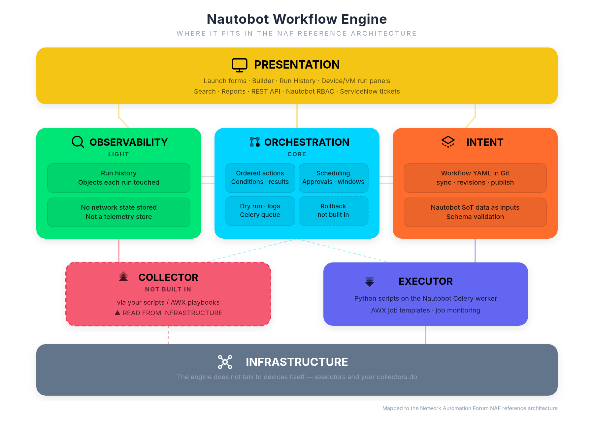
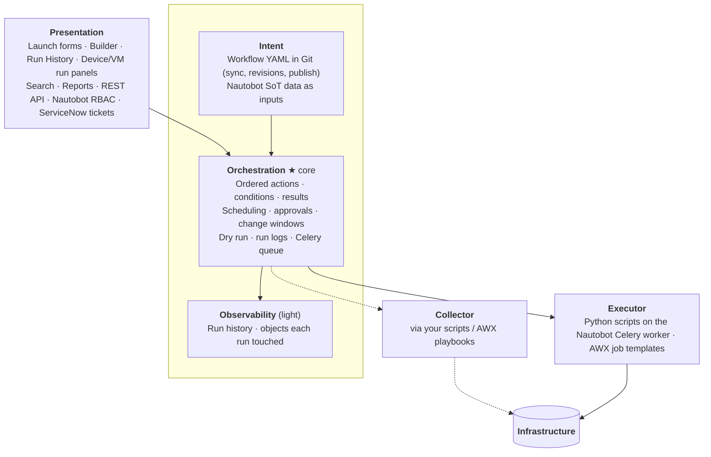

# App Overview

Workflow Engine turns workflow definitions into launch forms and runs inside Nautobot.
Engineers build them in a visual builder or in YAML, operators run them from a form
without touching code, and every run is recorded.

## Capabilities

- Build workflows in a [visual builder](builder.md): inputs, steps, conditions, schedule and approval, with a live launch form preview, [Preview run](preview_run.md), drafts, versions and one-click publish.
- Publish to Git and import changes from Git, with failures explained in plain words. See [Publishing and versions](publishing.md).
- Write a starter script from the builder that prints every value it receives. See [New scripts from the builder](placeholder_scripts.md).
- Synchronize workflow definitions, Python scripts, helpers, and filters from repositories.
- Collect typed inputs, including Nautobot objects, dependent choices, and tabular data.
- Run ordered pre-actions, main actions, and post-actions with reusable results.
- Launch Nautobot scripts or AWX job templates and monitor their outcomes.
- Schedule runs, optionally using a validated ServiceNow change window.
- Browse run history, execution logs, and time saved on the [dashboard](app_reporting.md).

## Where It Fits in NAF

The Workflow Engine is primarily the Orchestration block of the
[NAF reference architecture](https://reference.networkautomation.forum/Framework/Framework/).
It also provides Presentation and Intent features, and it delegates network
writes to executors rather than talking to devices itself.

Mermaid source

| NAF block | What the Workflow Engine provides |
| --- | --- |
| **Presentation** | Launch forms, the visual builder, Run History and the run pages, the Workflow runs panels on device and VM pages, global search, reports with time savings, and the REST API. Login and permissions come from Nautobot's RBAC, and ServiceNow change tickets are the ITSM tie-in. |
| **Intent** | Workflow YAML versioned in Git and synced through Nautobot's Git repository integration (webhooks, revisions, and publishing back to Git), with schema validation. Nautobot's own data (devices, VMs, IPAM) is used as typed inputs. |
| **Orchestration** (core) | Pre, main, and post actions in order, conditions, passing results between steps, immediate or scheduled runs, Nautobot approvals, ServiceNow change-window gates, dry run and preview, and a full run log for traceability. Runs are queued to the Nautobot Celery worker. |
| **Executor** | Python scripts executed on the Nautobot Celery worker (in-process, not sandboxed), and AWX job templates with job monitoring. |
| **Observability** (light) | Run history and the record of which objects each run touched. The engine does not store network state. |
| **Collector** | Not built in. Your scripts or AWX playbooks can collect data from the network. |
| **Infrastructure** | The devices and systems the executors talk to. The engine does not touch this layer itself. |

The NAF Orchestration block also calls for rollback and compensating actions.
The engine does not provide those as a built-in feature.

## Execution Model

Nautobot repository synchronization stores workflow definitions and scripts in app
models. Launching a workflow validates the form and creates a run. Background workers
execute the actions and record status, inputs, results, and logs. AWX runs are monitored
by background tasks; ServiceNow is consulted only for workflows using its change windows.

Workflow execution logging is intentional and is part of the operator experience.
Workflow authors and administrators must decide which data is appropriate to submit
and print. See [security and data handling](../admin/security.md).

## Prerequisites and Next Steps

A working Nautobot deployment, its background workers, and access to a trusted workflow
repository are required. AWX and ServiceNow are optional. Individual workflows may need
additional apps, Python dependencies, permissions, or remote services.

Start with [installation](../admin/install.md), then follow the
[first workflow tutorial](app_getting_started.md) and the
[examples tutorial](examples_tutorial.md). See the
[builder guide](builder.md) and the [YAML reference](app_use_cases.md) for more advanced definitions, and the
[reporting dashboard](app_reporting.md) for usage and time-savings reporting.
