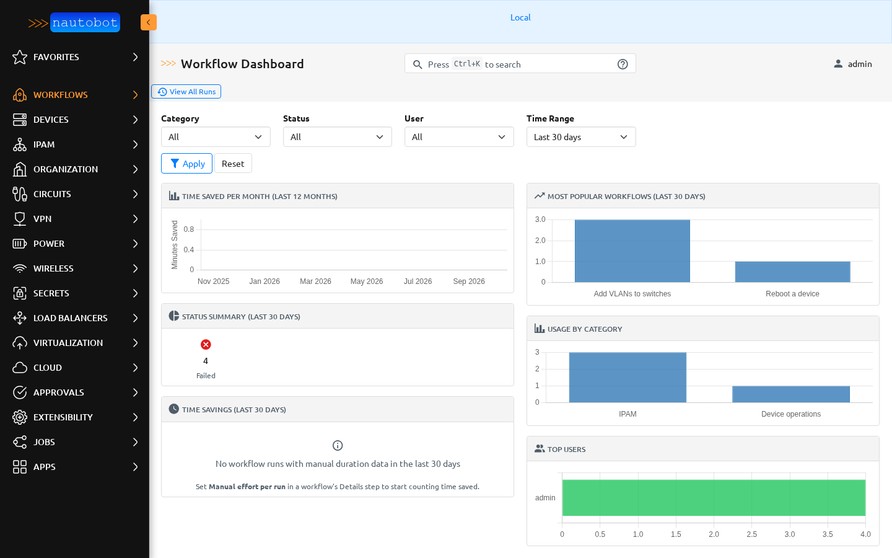
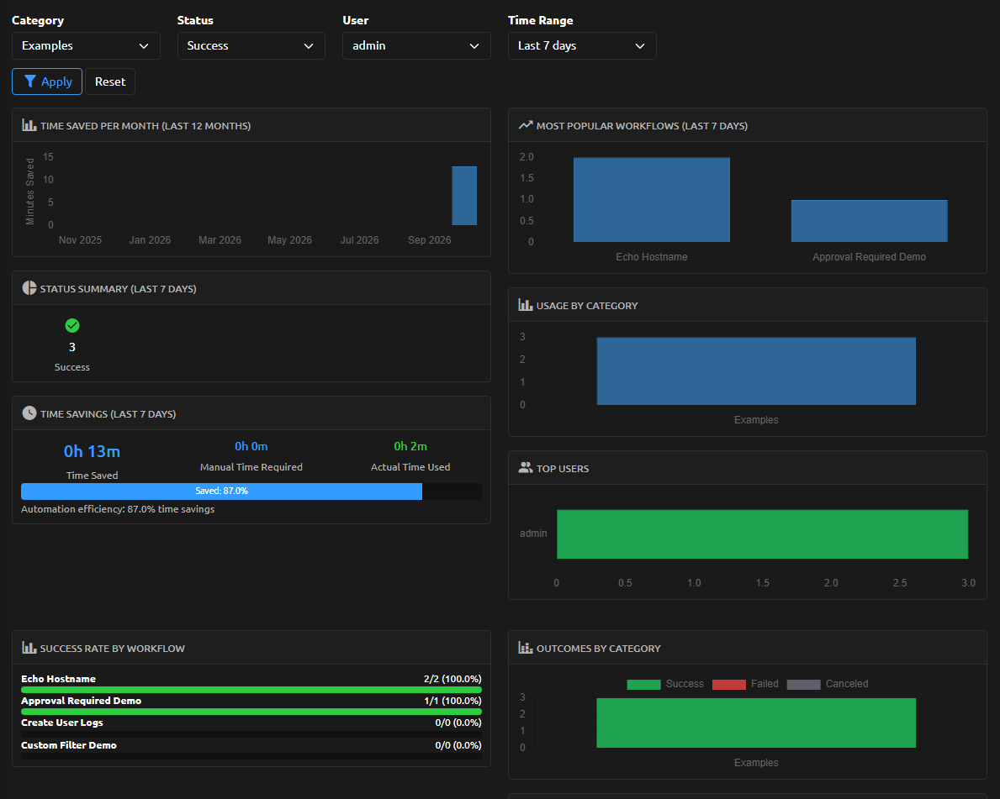
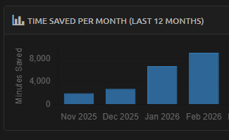

# Dashboard and time saved

The reporting dashboard summarizes how your workflows are being used. It is
permission-aware: every figure is computed only over the workflow runs the viewer
is allowed to see, so it reflects the same scope as the rest of the app. Open it
from **Workflows → Dashboard**. See
[granting permissions](../admin/install.md#permissions) for how to control that
scope.

## What the Dashboard Shows

- **Status summary** — the number of runs in each status (scheduled, pending,
  running, success, failed, canceled, partial) within the selected time window.
- **Workflow popularity** — the top 10 workflows by total run count.
- **Category usage** — run counts grouped by workflow category.
- **Top users** — the most active users by number of runs.
- **Success rate by workflow** — for the top 10 workflows by run count, the total
  run count, the number of successful runs, and the resulting success percentage.
- **Time savings** — the estimated time saved across the selected window, broken
  into estimated manual time versus measured automation time.
- **Monthly time savings** — the same savings figure aggregated per month over the
  last 12 months.
- **Success by category** — for each category, the run counts per status, the
  total, and the category success rate.
- **Usage over time** — run counts over the selected window, bucketed by day (when
  the window is 90 days or less) or by week (for longer windows).

## Filters

The dashboard accepts these filters, all of which narrow the set of runs every
figure is computed from:

- **Category** — a single workflow category (or the *uncategorized* bucket).
- **Status** — a single run status.
- **User** — a single requesting user.
- **Time range** — a preset of 7, 30, 90, or 365 days, ending at now.
- **Start / end** — an explicit date range that overrides the preset when set.

## Permission Awareness

The dashboard is built from the runs the viewer is allowed to view. Before any
figure is computed, the base run set is filtered to the `WorkflowRun` objects the
viewer has the **View** (`view_workflowrun`) permission for. Every metric — status
summary, popularity, category usage, top users, success rates, time savings, and
usage over time — is then calculated from that filtered set only. A user with a
constrained `view_workflowrun` therefore sees a dashboard scoped to exactly the
runs they can see. See [granting permissions](../admin/install.md#permissions).

## Time Savings

Set **Manual effort per run (minutes)** on the workflow's **Details** step in the
[builder](builder.md#details) (`manual_duration_minutes` in YAML) as an **estimate** of
how long the task takes by hand. It is not a measurement of actual execution time. The
builder shows a worked example under the field, and the launch page shows it under
**About** as *By hand it takes*.

The Workflows list shows time saved in the last 30 days in its summary cards, and the
launch page's **What happens** ends with the effort the dashboard will record.

- **Total time savings** is calculated over the selected window's **successful**
  runs only. For each successful run it adds the workflow's
  `manual_duration_minutes` to the estimated manual total and measures the
  automation time (the run's execution time plus its recorded form-fill time). The
  savings is the estimated manual total minus the measured automation total.
- **Monthly time savings** applies the same calculation per month over the last
  12 months.

Because only `success` runs count, a workflow with no successful runs in the window
contributes nothing to the savings figures. Leave the field empty
for a workflow to exclude it from time-savings reporting. When no workflow in the window
has it set, the dashboard says so and points to the Details step.

