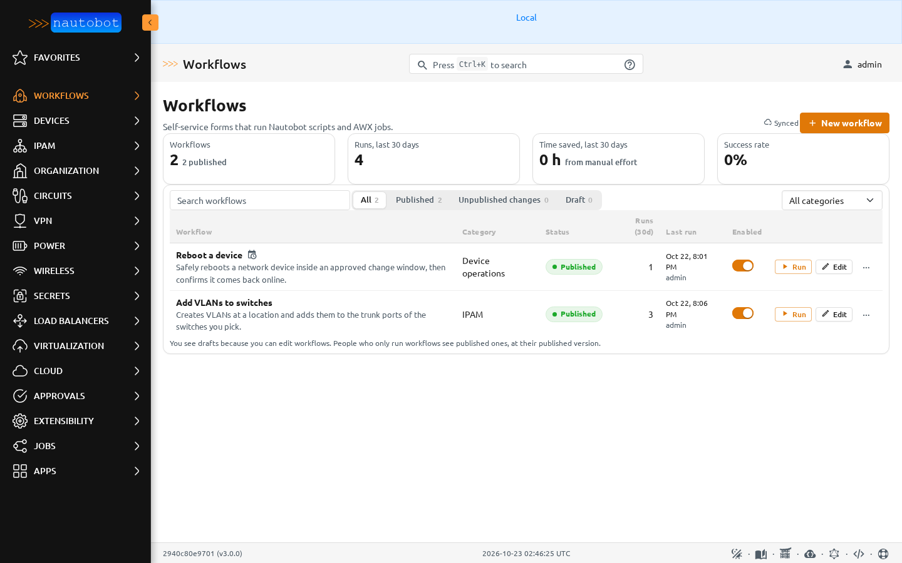
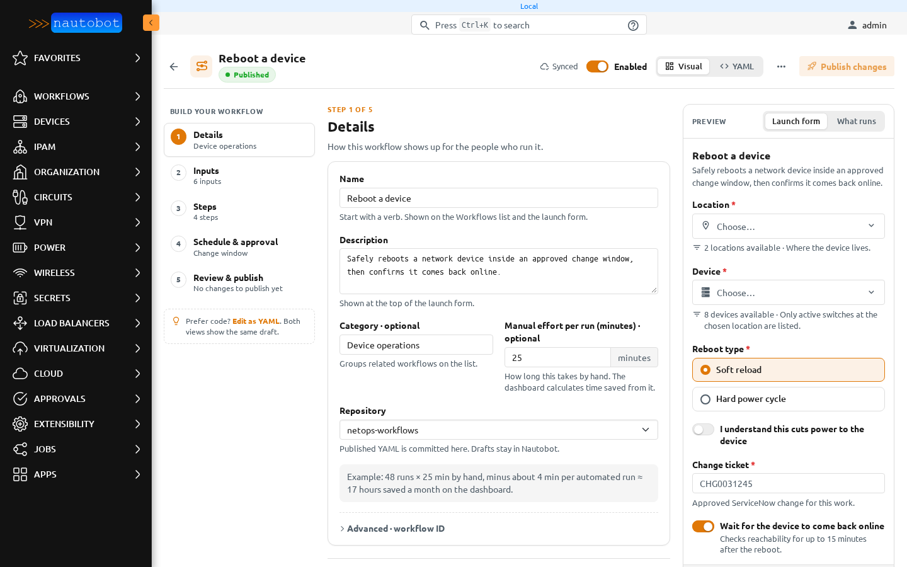
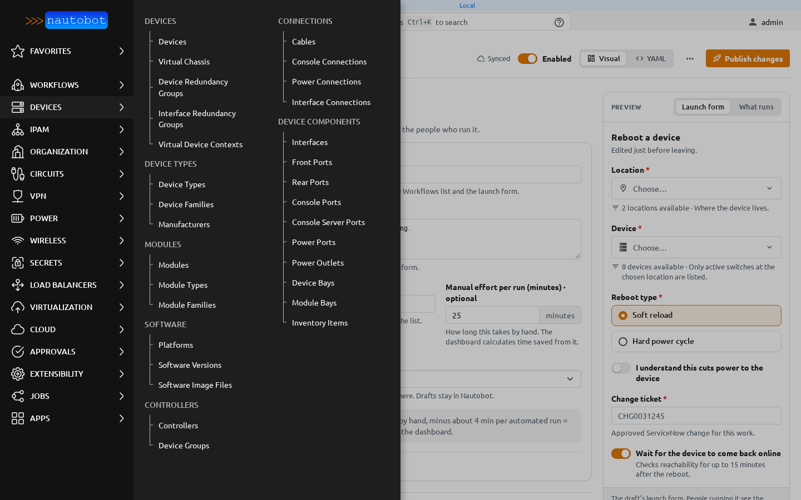
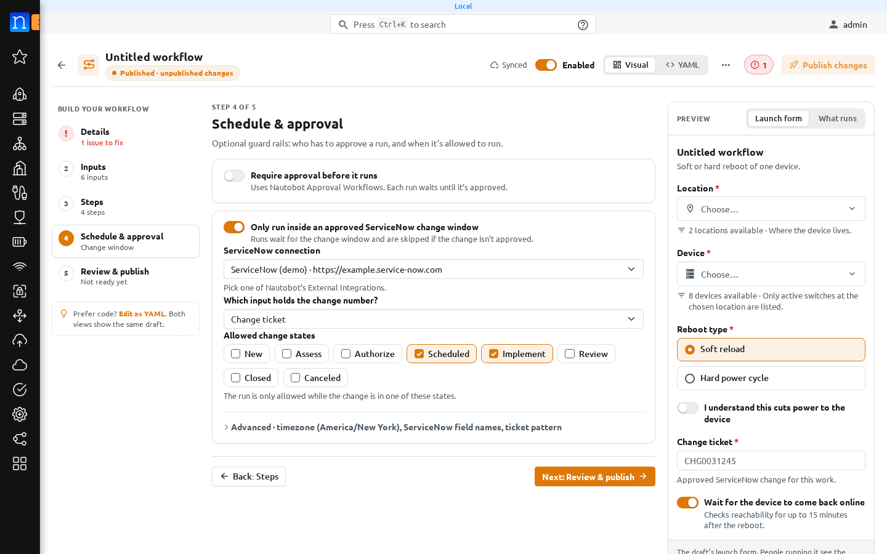

# The workflow builder

The builder is where workflows are made and changed. Open **Workflows** in the Nautobot menu, then choose **New workflow**, or **Edit** on a row.

## The Workflows list

Every workflow is on one list. Each row shows its status, category, how often it ran in the last 30 days, its last run, and the **Enabled** switch. **Run** opens the launch page. **Edit** opens the builder. The **⋯** menu on a row has **Versions**, **Duplicate**, **Run history**, **Download YAML**, and **Delete…**.

The cards above the list count workflows, runs in the last 30 days, time saved, and the success rate. The filters are **All**, **Published**, **Unpublished changes**, and **Draft**. People without edit rights only see published workflows.

## Layout

The builder has three columns:

- **Build your workflow** on the left. It lists the five steps: **Details**, **Inputs**, **Steps**, **Schedule & approval**, and **Review & publish**. Each shows a check, its number, or a red issue count. **Back** and **Next** at the bottom of each step move between them.
- The step you are working on, in the middle.
- **Preview** on the right. **Launch form** shows the form exactly as people running the workflow will see it, filled in with whatever you type there. **What runs** lists the steps in the order they run.

The header holds the name and status, the Git indicator, **Enabled**, **Visual** / **YAML**, the **⋯** menu, and **Publish changes**. The **⋯** menu has **Versions**, **Preview run**, **Download draft YAML**, **Duplicate**, and **Discard draft…** (or **Delete this draft…** for a workflow that was never published).

Nautobot's own sidebar keeps working while the builder is open. Its menus open over the builder, so you can leave for any Nautobot page at any time.

## Saving and status

There is no Save button. Every change is saved into one shared draft within about a second. The header reads **Saving…**, then **Draft saved · just now**, or names the person who last changed the draft. A change you make just before leaving the page is still saved.

People running the workflow keep the published version until someone publishes the draft. The status pill, in the header and on the list, is one of:

| Status | Meaning |
| --- | --- |
| **Draft** | Never published. Only editors can see it, and it isn't on Run yet. |
| **Published** | People run what the builder shows. |
| **Published · unpublished changes** | People run the published workflow. The draft has changes that aren't live yet. |

Hover over or tab to the pill for a one-line explanation. See [Publishing and versions](publishing.md) for what happens when you publish.

## Issues

The builder checks the draft after every change: typing, picking from a list, toggling a switch, reordering, deleting, and undo. Problems appear on the field they belong to and as a red count beside that step in the stepper. The header shows one red count for the whole workflow. Click it to jump to the first step with an issue.

**Publish changes** stays off while there are issues, and its tooltip says why. When you fix a problem, its issue disappears straight away.

## Details

| Field | What it is for |
| --- | --- |
| **Name** | Shown on the Workflows list and at the top of the launch page. Start with a verb. |
| **Description** | Shown at the top of the launch form. |
| **Category** | Groups related workflows on the list. Optional. |
| **Manual effort per run (minutes)** | How long this job takes by hand. The dashboard uses it to count time saved. See [Dashboard and time saved](app_reporting.md). |
| **Repository** | The Git repository the published workflow is written to. If the repository isn't ready for publishing, the reason shows here in plain words. See [Publishing and versions](publishing.md#getting-a-repository-ready). |
| **Advanced · workflow ID** | The short ID used in the address of the launch page. It is made from the name and can't change after the first publish. |

## Visual and YAML

**Visual** is the form editor described in these pages. **YAML** shows the same draft as a YAML document. Editing YAML needs the *Author templates and scripts* permission. A YAML edit is checked as you type and errors are shown on their line. Both views always show the same draft. The format is described in the [YAML reference](app_use_cases.md) and the [schema reference](workflow_schema.md).

## Enabled

**Enabled** turns a workflow on or off for people running it. It applies immediately once the workflow has been published, and it doesn't make a new version. Turning it off keeps all run history.

## Next

- [Inputs](inputs.md): the fields people fill in.
- [Steps](steps.md): what runs.
- [Conditions](conditions.md): when a step runs.
- [Schedule and approval](schedule_approval.md): when a run is allowed.
- [Preview run](preview_run.md): check a draft without running anything.
- [Publishing and versions](publishing.md): make a draft live, and Git.
- [New scripts from the builder](placeholder_scripts.md).
