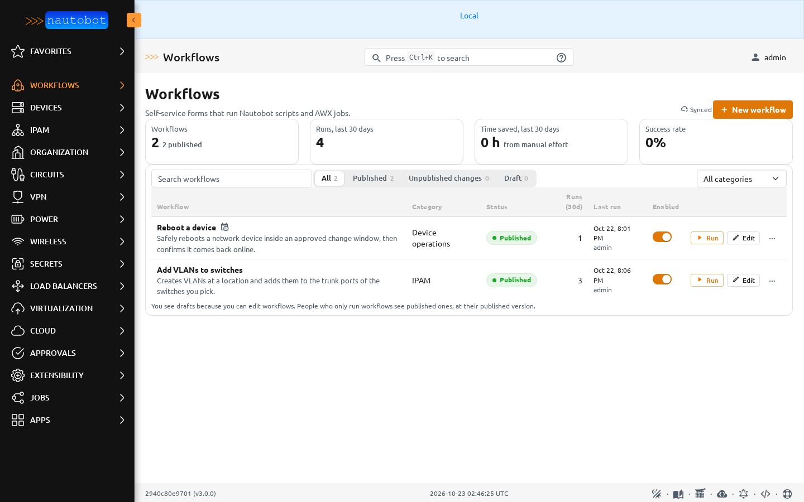
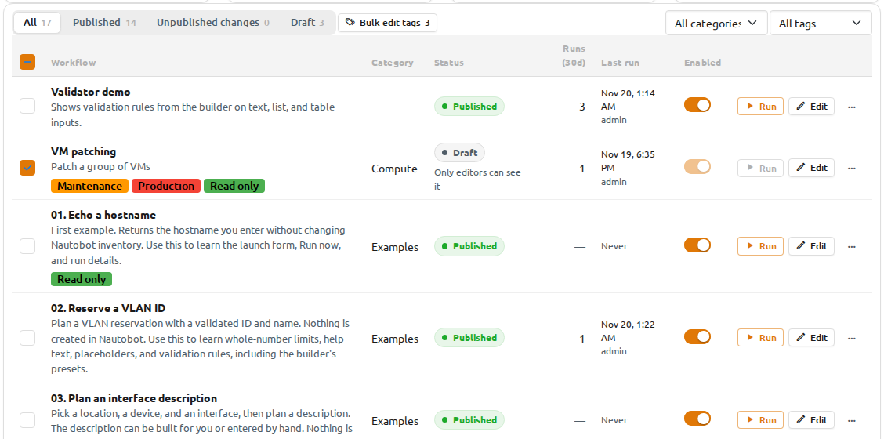
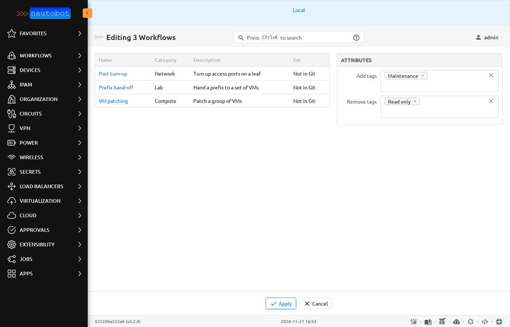
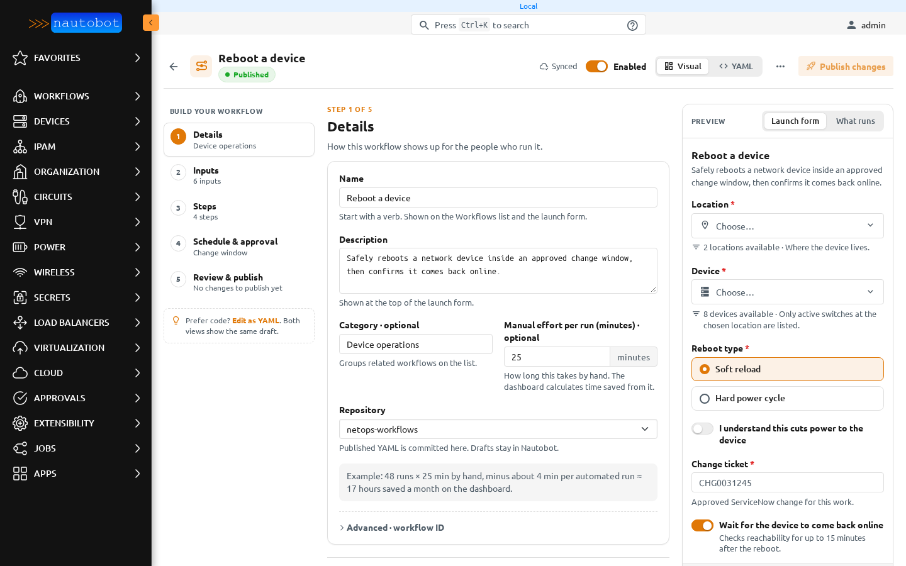
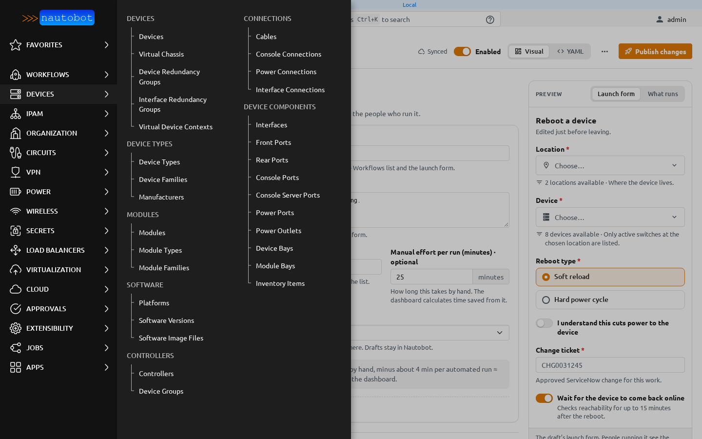
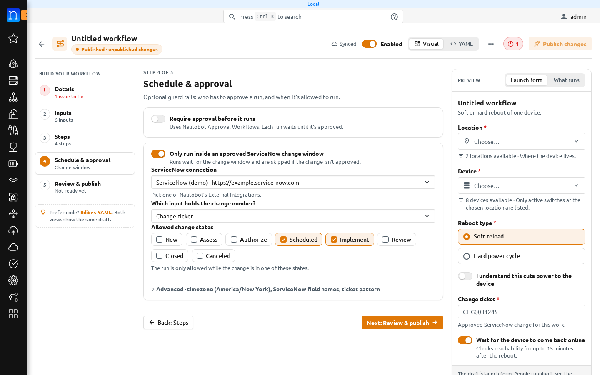
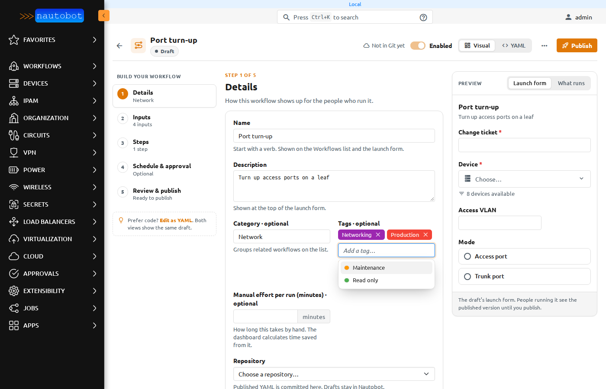
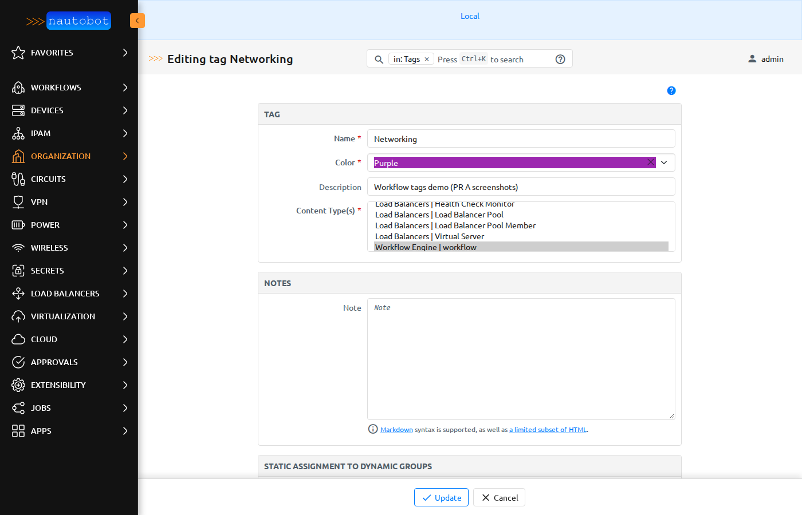
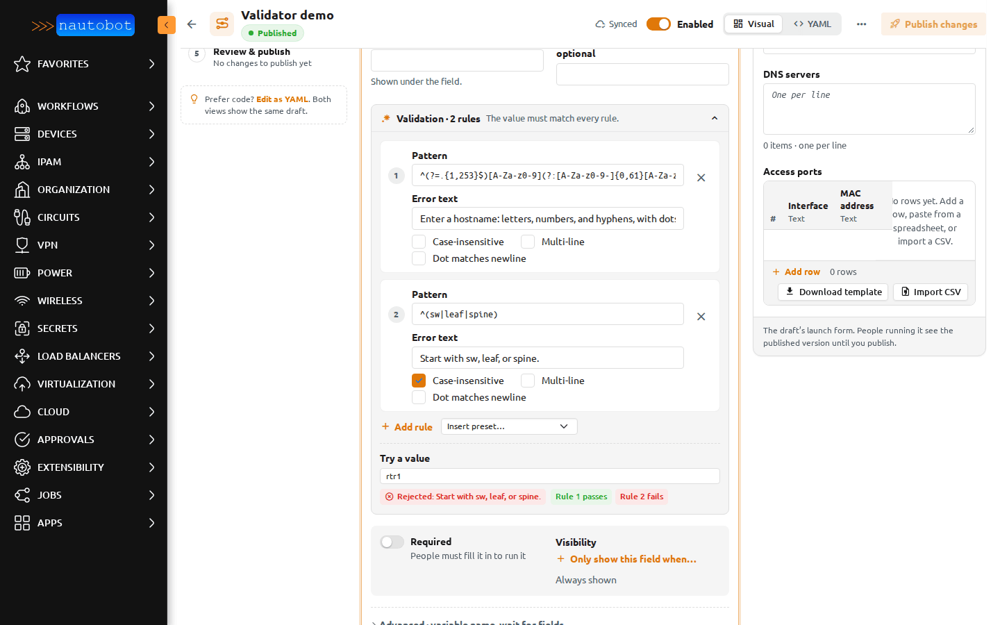

# The workflow builder

The builder is where workflows are made and changed. Open **Workflows** in the Nautobot menu, then choose **New workflow**, or **Edit** on a row.

## The Workflows list

Every workflow is on one list. Each row shows its status, category, how often it ran in the last 30 days, its last run, and the **Enabled** switch. **Run** opens the launch page. **Edit** opens the builder. The **⋯** menu on a row has **Versions**, **Duplicate**, **Run history**, **Download YAML**, and **Delete…**.

The cards above the list count workflows, runs in the last 30 days, time saved, and the success rate. Canceled runs and runs blocked by a freeze are left out of that 30-day run count and the success rate. The filters are **All**, **Published**, **Unpublished changes**, and **Draft**. People without edit rights only see published workflows. To find a workflow by name, key, category or description, use the search box at the top of the page: on this list it shows **in: Workflows**, like **in: Devices** on the Devices list, and filters the list when you press Enter.

### Tags on the list

Each workflow's [tags](#tags) show as coloured chips under its name. Click a chip, or pick a tag from **All tags** beside **All categories**, to see only the workflows with that tag. The address then ends in `?tags=<name>`, the same as on Nautobot's own lists, so you can bookmark it.

### Bulk edit tags

People who can edit workflows see a checkbox on each row they're allowed to change, and a select-all box in the header. Select some rows, then choose **Bulk edit tags**. Nautobot's standard bulk edit page opens with two fields, **Add tags** and **Remove tags**, exactly like bulk edit on devices or locations. Choose **Apply**: Nautobot runs its *Bulk Edit Objects* job and shows the job result, which says how many workflows were updated.

Bulk edit changes tags and nothing else. Category is part of the YAML, so changing it makes a new version, and turning a workflow on goes through **Publish**. Workflows you can see but aren't allowed to change are left out, and every change is recorded in Nautobot's change log.

## Layout

The builder has three columns:

- **Build your workflow** on the left. It lists the five steps: **Details**, **Inputs**, **Steps**, **Schedule & approval**, and **Review & publish**. Each shows a check, its number, or a red issue count. **Back** and **Next** at the bottom of each step move between them.
- The step you are working on, in the middle.
- **Preview** on the right. **Launch form** shows the form exactly as people running the workflow will see it, filled in with whatever you type there. **What runs** lists the steps in the order they run.

The header holds the name and status, the Git indicator, **Enabled**, **Visual** / **YAML**, the **⋯** menu, and **Publish changes**. The **⋯** menu has **Versions**, **Preview run**, **Download draft YAML**, **Duplicate**, and **Discard draft…** (or **Delete this draft…** for a workflow that was never published).

Nautobot's own sidebar keeps working while the builder is open. Its menus open over the builder, so you can leave for any Nautobot page at any time.

## Saving and status

There is no Save button. Every change is saved into one shared draft within about a second. The header reads **Saving…**, then **Draft saved · just now**, or names the person who last changed the draft. A change you make just before leaving the page is still saved.

People running the workflow keep the published version until someone publishes the draft. The status pill, in the header and on the list, is one of:

| Status | Meaning |
| --- | --- |
| **Draft** | Never published. Only editors can see it, and it isn't on Run yet. |
| **Published** | People run what the builder shows. |
| **Published · unpublished changes** | People run the published workflow. The draft has changes that aren't live yet. |

Hover over or tab to the pill for a one-line explanation. See [Publishing and versions](publishing.md) for what happens when you publish.

## Issues

The builder checks the draft after every change: typing, picking from a list, toggling a switch, reordering, deleting, and undo. Problems appear on the field they belong to and as a red count beside that step in the stepper. The header shows one red count for the whole workflow. Click it to jump to the first step with an issue.

**Publish changes** stays off while there are issues, and its tooltip says why. When you fix a problem, its issue disappears straight away.

## Details

| Field | What it is for |
| --- | --- |
| **Name** | Shown on the Workflows list and at the top of the launch page. Start with a verb. |
| **Description** | Shown at the top of the launch form. |
| **Category** | Groups related workflows on the list. Optional. |
| **Tags** | Nautobot tags, kept in Nautobot and never in the YAML. Optional. See [Tags](#tags). |
| **Manual effort per run (minutes)** | How long this job takes by hand. The dashboard uses it to count time saved. See [Dashboard and time saved](app_reporting.md). |
| **Repository** | The Git repository the published workflow is written to. If the repository isn't ready for publishing, the reason shows here in plain words. See [Publishing and versions](publishing.md#getting-a-repository-ready). |
| **Advanced · workflow ID** | The short ID used in the address of the launch page. It is made from the name and can't change after the first publish. |

## Tags

Workflows carry the same colour-coded Nautobot tags as devices, locations and everything else. In **Details**, type in **Tags** to search, then pick a tag from the list. Each tag shows as a chip; the **×** on a chip removes it. Backspace in the empty search box removes the last one. Tags are saved with the draft like any other change, but they apply to the workflow straight away: they aren't part of a version and don't need publishing.

A tag only appears in the picker once it allows workflows. Open **Organization → Tags**, edit the tag (or add one), and add **Workflow Engine | workflow** to **Content Type(s)**. If no tag allows workflows yet, the picker says so and links to the Tags page.

Tags stay out of the YAML on purpose. They are Nautobot data, like the Enabled switch, so a Git sync never removes them and editing a file in the repository can't change them. See [Why aren't tags in my YAML?](faq.md#why-arent-tags-in-my-yaml).

The builder API (`/api/plugins/workflow-engine/workflows/`) returns each workflow's tags as `{"id", "name", "color"}`. To set them, send `"tags"` with tag names or IDs when you create, save, or publish a draft. An unknown tag, or one that doesn't allow workflows, is a 400 that names it, and nothing is saved. Tags you aren't allowed to see are left on the workflow.

## Visual and YAML

**Visual** is the form editor described in these pages. **YAML** shows the same draft as a YAML document. Editing YAML needs the *Build workflows* permission, like the rest of the draft. A YAML edit is checked as you type and errors are shown on their line. Both views always show the same draft. The format is described in the [YAML reference](app_use_cases.md) and the [schema reference](workflow_schema.md).

## Enabled

**Enabled** turns a workflow on or off for people running it. It applies immediately once the workflow has been published, and it doesn't make a new version. Turning it off keeps all run history.

## Validation rules

Text, list-of-text, and table inputs can check what people type before the workflow runs. Open an input, open **Validation**, then choose **Add rule** for your own pattern or **Insert preset** for a ready-made one: hostname, IPv4 address, IPv4 network (CIDR), MAC address, interface name, VLAN name, or ServiceNow change number. **Try a value** shows straight away whether a sample would be accepted and which message people would see.

A pattern that can't be read is flagged on its field and blocks publishing. See [Validation rules](inputs.md#validation-rules) for details.

## Next

- [Inputs](inputs.md): the fields people fill in.
- [Steps](steps.md): what runs.
- [Conditions](conditions.md): when a step runs.
- [Schedule and approval](schedule_approval.md): when a run is allowed.
- [Preview run](preview_run.md): check a draft without running anything.
- [Publishing and versions](publishing.md): make a draft live, and Git.
- [New scripts from the builder](placeholder_scripts.md).
