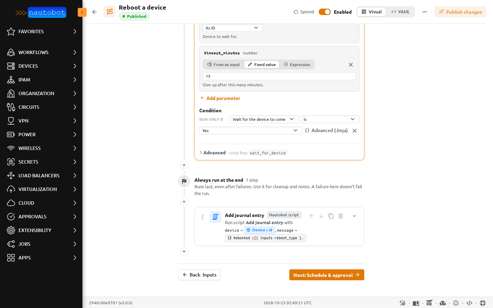
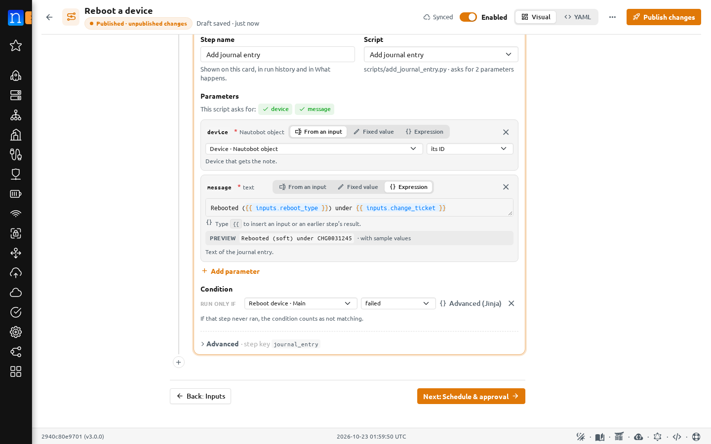
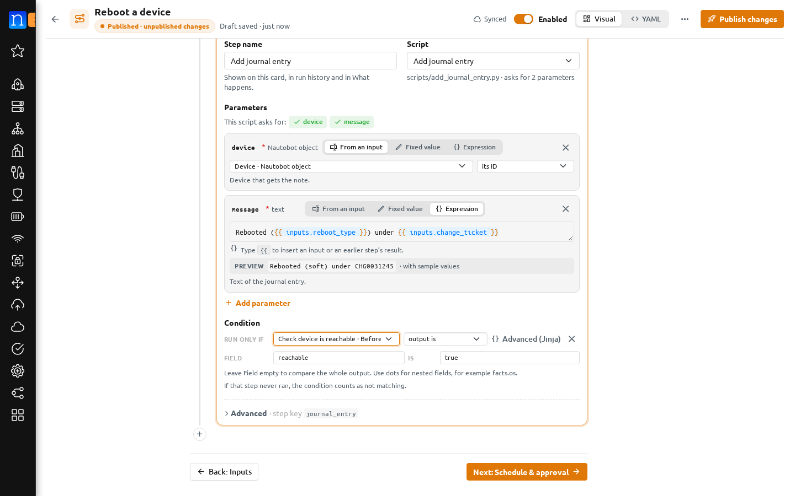

# Conditions

A condition decides whether a step runs. Open a step and find **Condition**. A step without one shows **Always runs**. Choose **Run only if…** to add one.



## Based on an input

Pick an input, an operator such as **is** or **is not**, and a value. For example, *Wait for device to come back* runs only if *Wait for the device to come back online* **is** *Yes*. The card shows the condition as a chip.

## Based on an earlier step

The first list also offers steps that run before this one. Steps that run later are not offered, so a condition can't depend on something that hasn't happened yet. **Before** steps can be used from **Main** and **Always run at the end**.

For a step you can test:

- **succeeded**
- **failed**
- **was skipped**
- **output is** or **output is not** a value. Leave **field** empty to compare the whole output, or name a field such as `reachable` to compare one part of it.





If the earlier step never ran, for example because its own condition was false, the test counts as not matching.

## Advanced (Jinja)

**Advanced (Jinja)** turns the condition into a template. The step runs when the template comes out as `true`, `1`, `yes`, `on` or `y`. The builder writes conditions like these:

```jinja
{{ inputs.wait_for_recovery }}
{{ results.check_reachable is defined and results.check_reachable.status == "failed" }}
{{ results.check_reachable is defined and results.check_reachable.return_value is mapping and results.check_reachable.return_value.reachable == true }}
```

Editing an advanced condition needs the *Author templates and scripts* permission unless it is a single reference.

## Checking conditions

[Preview run](preview_run.md) follows every condition with the values in the Launch form preview and says why a step would be skipped. When a condition depends on an earlier step's output, it says that the outcome can only be known in a real run.

The builder refuses a condition that tests its own step or a later step.
