# Examples Tutorial

This tutorial walks the ten example workflows in [Nautobot-Demo-Workflows](https://github.com/eric-fetty/Nautobot-Demo-Workflows), in order, from a first launch to a maintenance-window change. Each example adds one or two features. The YAML, scripts, and a short "what you'll learn / how to run / next" note for every workflow live in that repository.

The first five examples never change Nautobot inventory. Examples 6–10 have an **Apply these changes in Nautobot** switch that defaults to off. Leave it off to only plan. Turn it on only in a lab. None of these examples contact or reboot a live device, and none of them require AWX.

## Before you start

1. Install and configure the app. See [Install and configure](../admin/install.md). Background workers must be running.
2. Add [Nautobot-Demo-Workflows](https://github.com/eric-fetty/Nautobot-Demo-Workflows) as a Nautobot Git Repository. Under **Provides**, enable the Workflow Engine content. Synchronize it.

    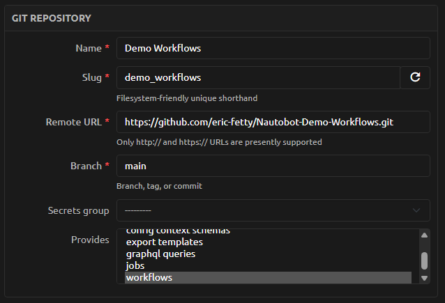

3. Confirm the ten **Examples** workflows appear on the **Workflows** list.

    

4. Use an account with permission to view workflows, run them, and view run results. See [Permissions](permissions.md).
5. For examples 3 and 6–10, seed the lab inventory (locations AMS01 and NYC02, demo switches, and a fake **ServiceNow (demo)** connection). Do not run the seed in production. The [lab setup section](https://github.com/eric-fetty/Nautobot-Demo-Workflows#lab-setup) in the examples repository describes the Job and the nbshell command.

Examples 1, 2, 4, and 5 can be run before you seed.

A screenshot of every launch form is not included here. The pictures in this tutorial are of the current UI (the Workflows list, launch options, run history, tables, Preview run, and so on) and apply across the ladder. Open the named workflow in your lab to see its form.

## 1. Echo a hostname

Workflow: [`01-echo-hostname`](https://github.com/eric-fetty/Nautobot-Demo-Workflows/blob/main/workflows/01-echo-hostname.yaml). Notes: [what you'll learn](https://github.com/eric-fetty/Nautobot-Demo-Workflows/blob/main/workflows/01-echo-hostname.md).

This is the first run: one text input and one Nautobot script that returns the hostname you enter.

1. Choose **Run** on **01. Echo a hostname**.
2. Enter `router.example.com`.
3. Leave **When should it run?** on **Run now** and submit.

    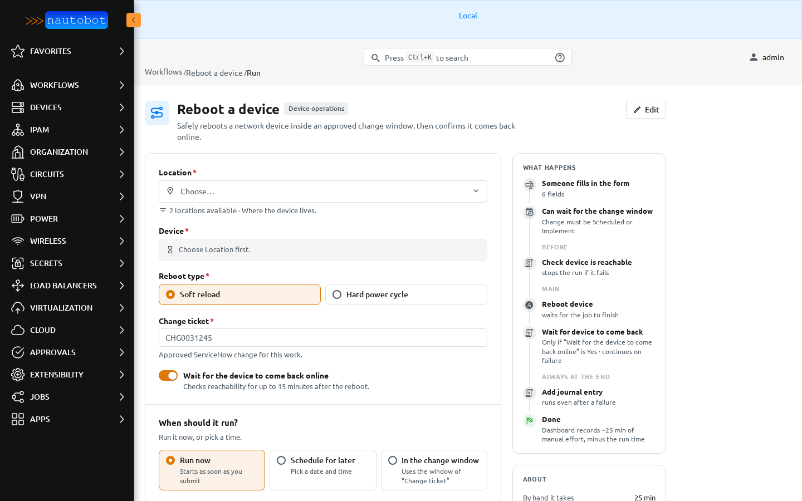

4. Open the run and inspect its status, the returned hostname, and the execution log.

    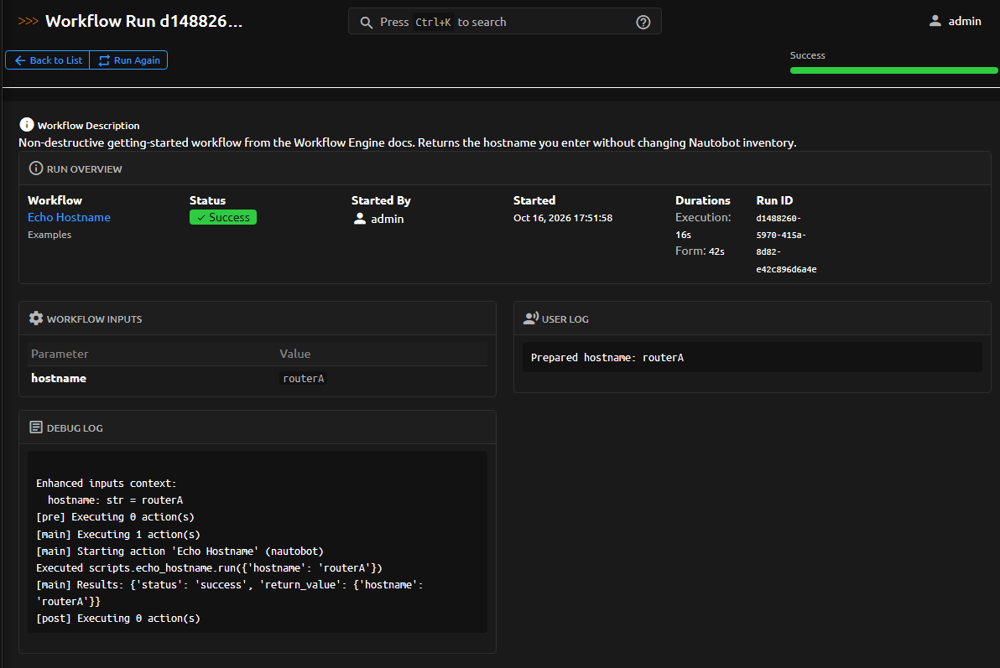

The workflow's **Manual effort per run (minutes)** is what the [dashboard](app_reporting.md) uses to estimate time saved after a successful run.

You can also build this same workflow in the builder without writing YAML. See [Or build it in the builder](app_getting_started.md#or-build-it-in-the-builder).

## 2. Reserve a VLAN ID

Workflow: [`02-reserve-vlan-id`](https://github.com/eric-fetty/Nautobot-Demo-Workflows/blob/main/workflows/02-reserve-vlan-id.yaml). Notes: [what you'll learn](https://github.com/eric-fetty/Nautobot-Demo-Workflows/blob/main/workflows/02-reserve-vlan-id.md).

This example adds a whole-number input with a minimum and a maximum, help text, a placeholder, and a regex rule on the VLAN name (with an optional `IGNORECASE` flag). Try an ID outside 1–4094 or a name with spaces and watch the form reject it before you submit. The script only returns a plan. Nothing is created in Nautobot.

## 3. Plan an interface description

Workflow: [`03-plan-interface-description`](https://github.com/eric-fetty/Nautobot-Demo-Workflows/blob/main/workflows/03-plan-interface-description.yaml). Notes: [what you'll learn](https://github.com/eric-fetty/Nautobot-Demo-Workflows/blob/main/workflows/03-plan-interface-description.md).

Run the lab seed first. This example introduces Nautobot object pickers: a location, then a device at that location, then an interface on that device, using `depends_on` and a filter. A choice of description style shows or hides later fields with `show_if`. A step condition decides whether the plan step runs.

    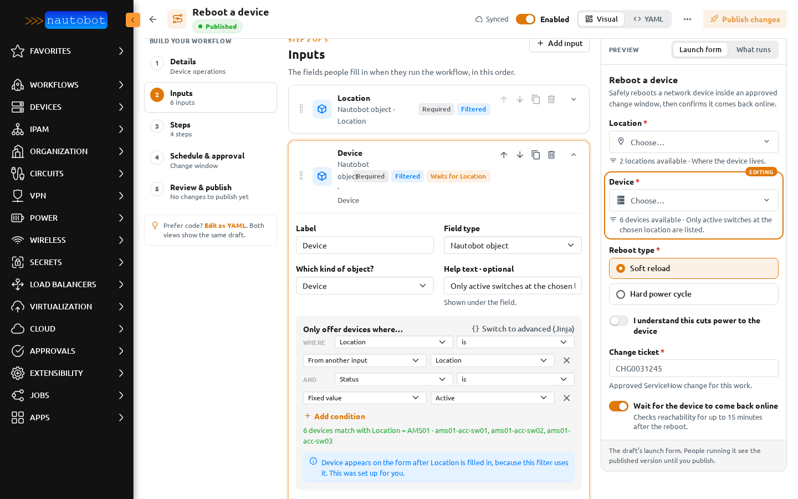

Pick AMS01, `ams01-acc-sw01`, and `Ethernet1/1`. Leave the style on the built-in option for the first run, then run again with a custom description and confirm that field appears. This workflow still only plans; it does not change the interface.

This is a good time to try [Preview run](preview_run.md) in the builder. It shows which steps would run, with the values from the launch-form preview, and it never executes a script or calls AWX.

    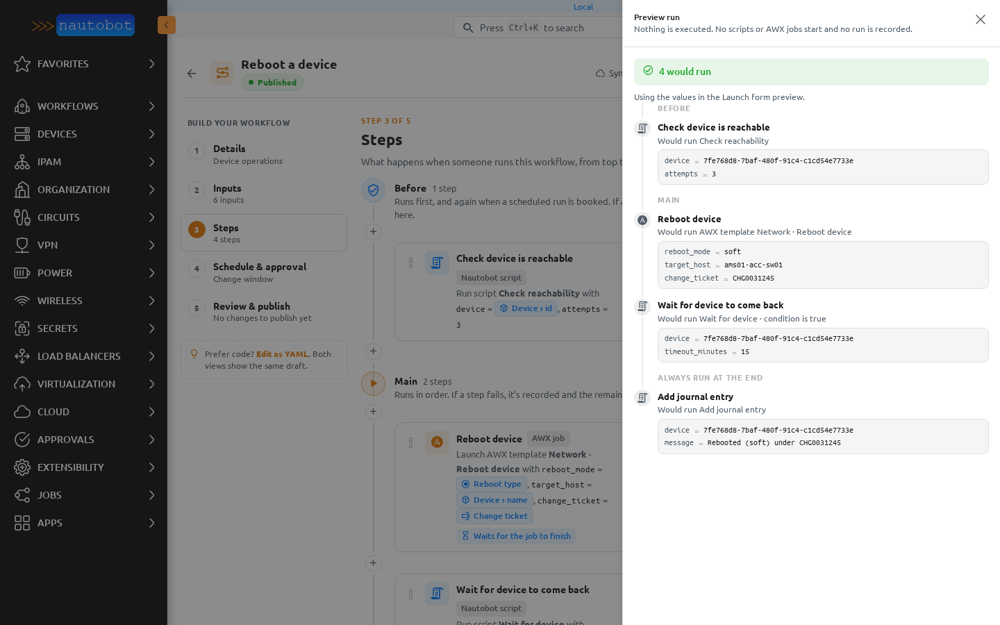

## 4. Normalize a hostname

Workflow: [`04-normalize-hostname`](https://github.com/eric-fetty/Nautobot-Demo-Workflows/blob/main/workflows/04-normalize-hostname.yaml). Notes: [what you'll learn](https://github.com/eric-fetty/Nautobot-Demo-Workflows/blob/main/workflows/04-normalize-hostname.md).

A custom Jinja filter, `normalize_for_dns`, lives in `filters/string_filters.py` and imports a shared helper from `scripts/lib`. Enter `My Router Host` or `bad_name_host` and confirm the action receives `my-router-host` or `bad-name-host`. The filter is used both in a parameter and in a `when` condition. Nothing in inventory is changed. See [Custom filters](../dev/extending.md).

## 5. Record a planned change

Workflow: [`05-record-planned-change`](https://github.com/eric-fetty/Nautobot-Demo-Workflows/blob/main/workflows/05-record-planned-change.yaml). Notes: [what you'll learn](https://github.com/eric-fetty/Nautobot-Demo-Workflows/blob/main/workflows/05-record-planned-change.md).

The change-ticket field comes from a shared fragment, included with ``. Include paths are resolved relative to the workflow file, and the fragment must use the indentation expected at the insertion point. The ticket must look like `CHG0031245`. Later examples reuse the same fragment. Nothing in inventory is changed.

## 6. Add VLANs

Workflow: [`06-add-vlans`](https://github.com/eric-fetty/Nautobot-Demo-Workflows/blob/main/workflows/06-add-vlans.yaml). Notes: [what you'll learn](https://github.com/eric-fetty/Nautobot-Demo-Workflows/blob/main/workflows/06-add-vlans.md).

This example introduces a table input (`listdict`) with typed columns, unique VLAN IDs, and row limits, plus a list of extra trunk ports, a pick-many tags field, and a several-objects picker for switches. On the launch form the table is an editable grid.

    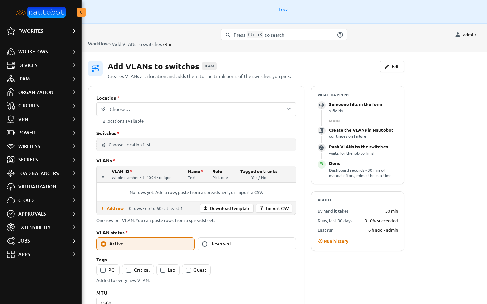

**Download template** and **Import CSV** read a file in your browser. The file is not uploaded or stored. Only the rows in the grid are sent with the form.

    

**Apply these changes in Nautobot** defaults to off. Leave it off to only plan. Turn it on only in this lab, to create (or reuse) VLANs at the location. Do not use Apply in production.

## 7. Turn up a port

Workflow: [`07-turn-up-a-port`](https://github.com/eric-fetty/Nautobot-Demo-Workflows/blob/main/workflows/07-turn-up-a-port.yaml). Notes: [what you'll learn](https://github.com/eric-fetty/Nautobot-Demo-Workflows/blob/main/workflows/07-turn-up-a-port.md).

Steps are grouped into **Before**, **Main**, and **Always run at the end**. If a Before step fails, nothing else runs. Always-after steps still run after a main failure.

    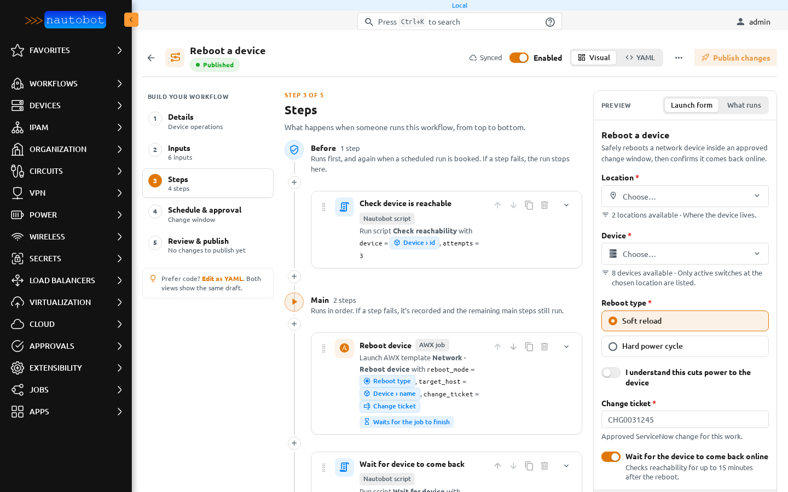

The Before step simulates a reachability check: it confirms the device exists in Nautobot and reports reachable. No packets are sent. The main step runs only if that check succeeded:

    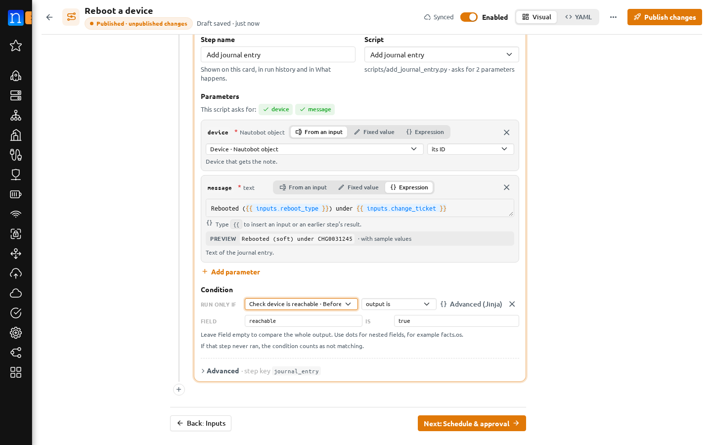

With Apply off, the main step only plans. With Apply on, it sets the interface description in this lab, and the always-after step adds a journal entry only when that main step succeeded.

[Preview run](preview_run.md) follows these conditions with the values in the launch-form preview. When a condition depends on an earlier step's output, it says that the outcome can only be known in a real run.

## 8. Approve a maintenance reboot

Workflow: [`08-approve-maintenance-reboot`](https://github.com/eric-fetty/Nautobot-Demo-Workflows/blob/main/workflows/08-approve-maintenance-reboot.yaml). Notes: [what you'll learn](https://github.com/eric-fetty/Nautobot-Demo-Workflows/blob/main/workflows/08-approve-maintenance-reboot.md).

This workflow sets `approval_required: true`. Approving a run is configured in Nautobot, not as a Workflow Engine permission.

    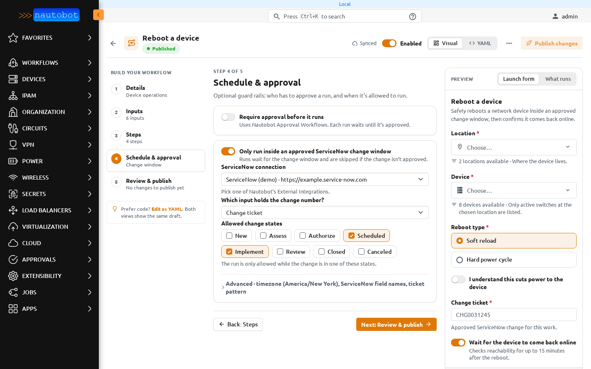

After Git sync, open **Approvals → Workflow Definitions**, find **Workflow Engine: 08-approve-maintenance-reboot**, and add at least one stage (an approver group and the minimum number of approvers). Until a stage exists, launches stay **Pending Approval**. Approvers use **Approvals → Approval Dashboard**. This example only records a plan. It never reboots a device.

On Nautobot versions before 3.2 the setting is kept and has no effect. See [Schedule and approval](schedule_approval.md).

## 9. Schedule inside a change window

Workflow: [`09-schedule-change-window`](https://github.com/eric-fetty/Nautobot-Demo-Workflows/blob/main/workflows/09-schedule-change-window.yaml). Notes: [what you'll learn](https://github.com/eric-fetty/Nautobot-Demo-Workflows/blob/main/workflows/09-schedule-change-window.md).

The launch form offers **Run now**, **Schedule for later**, and, when the workflow declares a ServiceNow window, **In the change window**.

    

The lab seed creates a fake External Integration named **ServiceNow (demo)** so this setting can be saved. It does not talk to a real ServiceNow. In a lab, choose **Schedule for later**, pick a time a few minutes ahead, and submit. **In the change window** succeeds only when you have pointed an integration at a real instance and enabled the sync job; see [Integrations](external_interactions.md#servicenow-change-windows).

Open **Workflows → Run History** to find the booked run.

    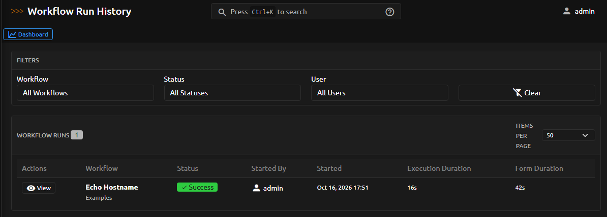

While a run is still **Scheduled** or **Pending Approval**, **Cancel Run** is available on the run's page. A running workflow cannot be interrupted.

    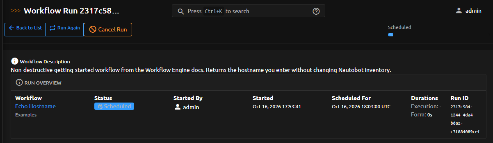

After a run finishes, **Run Again** on that page opens the launch form with the earlier inputs already filled in. The address includes `?from_run=<id>`. The form is filled only when you are allowed to view that run.

## 10. Maintenance-window change

Workflow: [`10-maintenance-window-change`](https://github.com/eric-fetty/Nautobot-Demo-Workflows/blob/main/workflows/10-maintenance-window-change.yaml). Notes: [what you'll learn](https://github.com/eric-fetty/Nautobot-Demo-Workflows/blob/main/workflows/10-maintenance-window-change.md).

This capstone combines the earlier rungs: a VLAN table, several devices, the shared change ticket, a Before reachability check, a main plan or apply, an always-after journal entry when Apply succeeded, and a backout note when the main step failed. It also opts into Nautobot approval and declares the same ServiceNow change window as example 9.

Add an approval stage for **Workflow Engine: 10-maintenance-window-change**, leave Apply off for the first run, and use **Schedule for later** or **Run now**. **In the change window** needs a real ServiceNow, as in example 9.

## Git sync and publish

The published workflow lives in Nautobot and in a file in its Git repository. After you synchronize the examples repository, the ten workflows are the live versions people can run. If you edit one in the builder and have the *Publish workflows* permission, **Review & publish** writes a new version back to Git.

    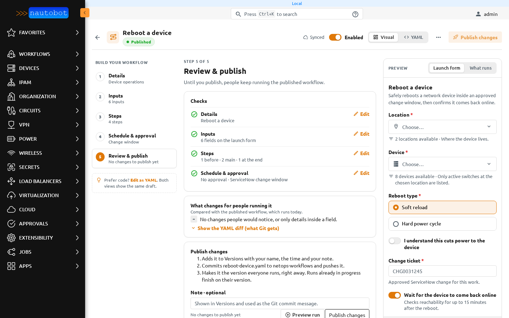

The header shows whether Git has the published version. If a push fails, **Not synced · Retry** explains why. When someone publishes a change straight to Git while you edit, a banner offers **Compare** or **Load their version**. See [Publishing and versions](publishing.md) and [Two-way Git sync](git_sync.md).

A repository has to be set up for publishing once: **Provides** includes **workflows**, and a secrets group with an HTTP(S) token is in place.

    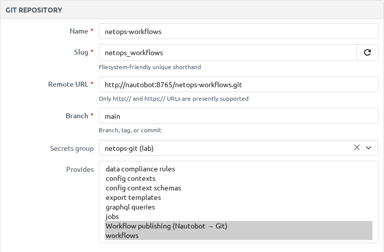

## Preview run

**Preview run** in the builder renders conditions and parameters from the launch-form preview. It never runs a script, calls AWX, or records a run. You need the *Build workflows* permission to use it. See [Preview run](preview_run.md).

    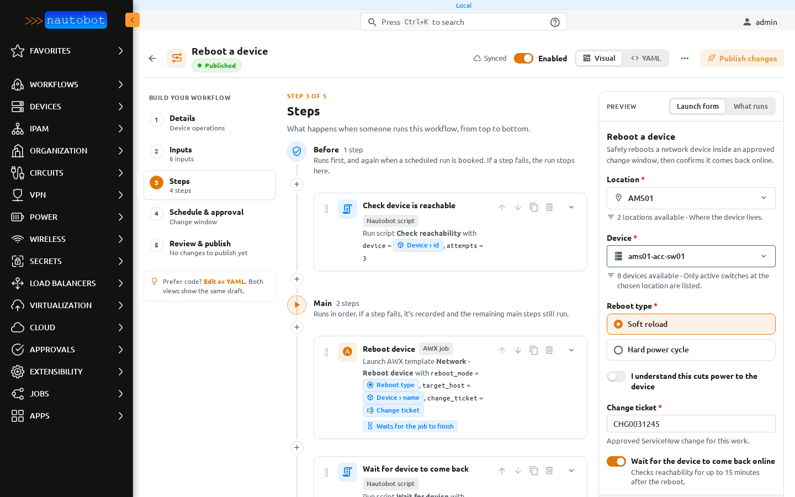

## Run history, cancel, and Run Again

**Workflows → Run History** lists runs with their status, who started them, when, and how long they took.

    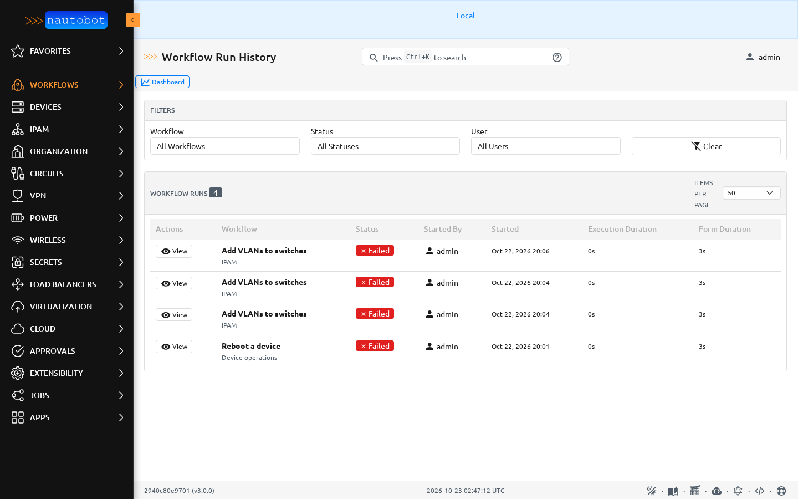

A run's page shows the inputs, each step's result, and the logs. **Cancel Run** works only while the run is **Scheduled** or **Pending Approval**. **Run Again** prefills the launch form from that run when you are allowed to view it, using `?from_run=<id>`. See [Running a workflow](launch.md).

## Time-savings dashboard

After you have a few successful runs, open the reporting dashboard. It uses each workflow's **Manual effort per run (minutes)** minus the automated run time.

    

    

See [Dashboard and time saved](app_reporting.md).

## Permissions

The app creates ready-made permissions when it is installed. They are not given to anyone until an admin assigns them.

    

A typical operator needs **Run workflows** and **View runs**. Approving a run is not a Workflow Engine permission; it is set on the Nautobot approval definition. See [Permissions](permissions.md).

## New scripts from the builder

In a step, **New script…** writes a starter script that prints the values it receives. The builder never runs that code to find out what the script needs, and it never executes the new file when you create it. *Write scripts* is required to type the code and commit it; without that permission the panel is read-only with **Copy code**.

    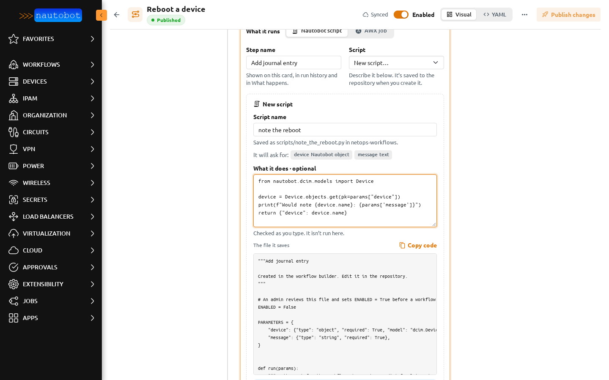

See [New scripts from the builder](placeholder_scripts.md).

## Next

- [The workflow builder](builder.md) and the [YAML reference](app_use_cases.md) for authoring your own workflows.
- [Integrations](external_interactions.md) if you later add optional AWX job templates or a real ServiceNow connection.
- [Security and data handling](../admin/security.md) before you submit operational data.
