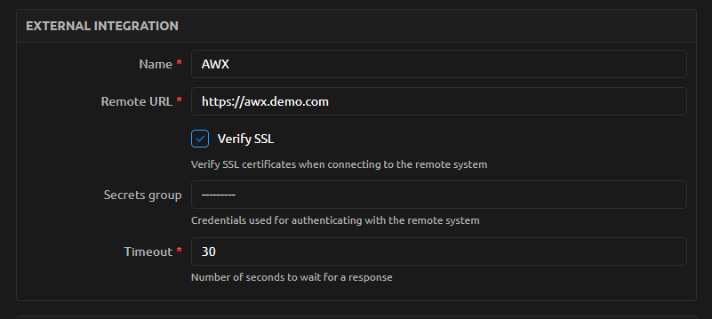
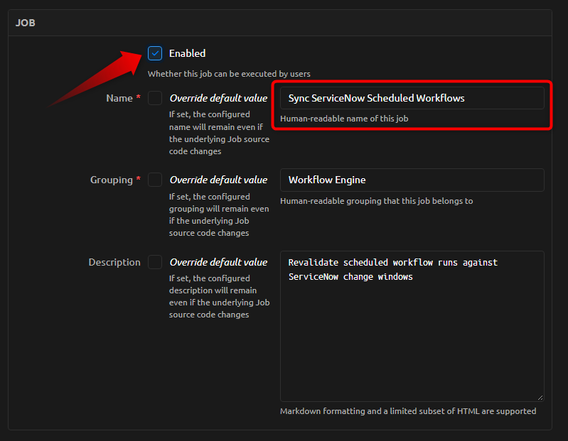

# Integrations

AWX and ServiceNow are optional. The [first workflow](app_getting_started.md) runs
without either service. Worker processes need network access to any service called
by their actions. Use HTTPS, verified certificates, and least-privilege accounts.

## AWX

Create a Nautobot External Integration whose name matches the
**AWX connection** setting (default: `AWX`) on the
[Settings page](../admin/install.md#settings-page). Set its
remote URL to the AWX base URL, enable SSL verification, and attach a Secrets Group
containing **Generic** access-type **Username** and **Password** secrets. The current
client uses these credentials for HTTP basic authentication; it does not consume
token secrets.



Grant the account permission to launch the selected job templates and read their
job status. Configure those templates to accept the extra variables supplied by
the workflow.

```yaml
actions:
    - type: awx
        name: Run Inventory Check
        template_id: 123
        extra_vars:
            hostname: "{{ inputs.hostname }}"
```

The template ID is an example; use a template approved for your environment. The
engine calls the AWX job-template launch endpoint and monitors the resulting job
through background tasks. Run details include its status and a link to AWX.

## ServiceNow Change Windows

Create an External Integration named `ServiceNow` with the instance's HTTPS base
URL and SSL verification enabled. Attach **Generic** access-type **Username** and
**Password** secrets. Grant the account access to the change records and fields
required by your scheduling policy.

Enable ServiceNow scheduling in an individual workflow:

```yaml
schedule:
    servicenow:
        change_input_key: change_ticket
        allowed_states:
            - scheduled
            - implement
        timezone: UTC
        start_fields:
            - start_date
        end_fields:
            - end_date
inputs:
    - key: change_ticket
        label: Change Ticket
        type: string
        required: true
```

When the user chooses **Use ServiceNow Change Window**, the engine validates the
ticket and its usable change window. Field names and state values must match the
instance's configuration. The timezone applies to timestamps without an explicit
offset; verify that it matches the source data. It must be an IANA name that
Python's `zoneinfo` knows (for example `Europe/Amsterdam`) or `UTC`, and defaults
to UTC when empty. In the builder it is a searchable list under **Schedule &
approval → Advanced**. Scheduling validation also occurs
in later scheduling/execution phases, so a change in ticket state can affect a run.
The value of the `change_input_key` input also appears in the scheduled job title
shown to approvers (see [Requiring Nautobot Approval](app_use_cases.md#requiring-nautobot-approval-32)).

### Keeping Scheduled Runs in Sync with ServiceNow

A run scheduled from a change window records that window when the run is created.
The change record can move or become invalid afterward, so the app installs a
Nautobot job named **Sync ServiceNow Scheduled Workflows** that revalidates every
scheduled ServiceNow-backed run against its current change ticket. For each run it
reschedules the execution if the window has moved and cancels the run if the
ticket is no longer in an allowed state.

Unlike the hidden executor and orphan-cleaner jobs (which the app enables for
you during install / `post_upgrade`), **this ServiceNow sync job stays disabled
until you turn it on**. If you skip the steps below, a run can still fire even
though the underlying change window has moved or the ticket has been invalidated.

#### Step 1: Enable the job

1. Log in to Nautobot as a user who can manage jobs.
2. In the top navigation, open **Jobs**, then click **Jobs** again (the job list).
3. Find **Sync ServiceNow Scheduled Workflows**.
   - It is listed under the **Workflow Engine** grouping.
   - It is a **visible** job (you do not need the “show hidden” filter).
4. Click the job name to open its detail page.
5. Click **Edit**.
6. Check the **Enabled** box.
7. Click **Save**.



Confirm the job detail page now shows the job as enabled. If it is still
disabled, scheduled sync will not run.

#### Step 2: Schedule it to run on a recurring interval

Enabling the job alone is not enough. You must also create a schedule so Nautobot
runs it regularly:

1. Stay on (or reopen) **Sync ServiceNow Scheduled Workflows**.
2. Create a **Scheduled Job** / schedule for this job (Nautobot’s schedule UI on
   the job, or **Jobs → Scheduled Jobs** then add a schedule that points at this
   job).
3. Choose a **recurring** interval. A good starting point is every **15** or
   **30** minutes, or match your change-management cadence.
4. Save the schedule and confirm it appears under **Jobs → Scheduled Jobs** and
   is enabled.

    

#### Step 3: Confirm workers are running

The sync job (and any scheduled workflow run) only executes if Nautobot’s
background **worker** and **scheduler** services are running. See the
[install prerequisites](../admin/install.md#prerequisites).

After a successful sync run, check **Jobs → Job Results** for that job. The job
logs how many runs it synced, rescheduled, and canceled.

!!! warning
    If you enable the job but never create a recurring schedule, nothing keeps
    local schedules aligned with ServiceNow. Stale change windows can still fire.

!!! note
    This job only refreshes the schedule; it does not execute runs. Firing a run
    still goes through **Execute Scheduled Workflow** (already enabled by the
    app). Cancellation follows the normal scheduled-run rules.

## Workflow-Specific Services

Python actions can call other approved services. Install any required dependencies
in the deployment and configure their credentials outside the workflow definition.
Vendor-specific examples, such as Cisco ACI workflows, require their own inventory,
models, helpers, and service access. They are not prerequisites for the engine.

See [security and data handling](../admin/security.md) before sharing workflow inputs,
integration diagnostics, or screenshots.
