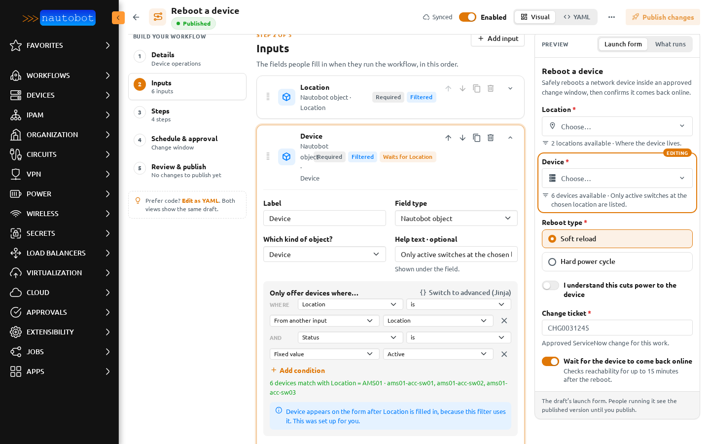
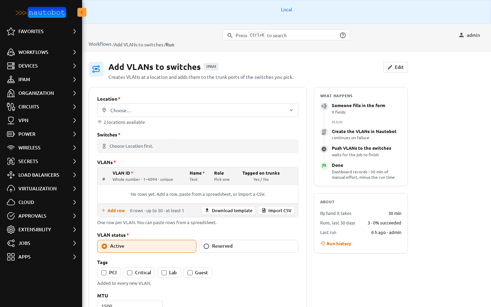
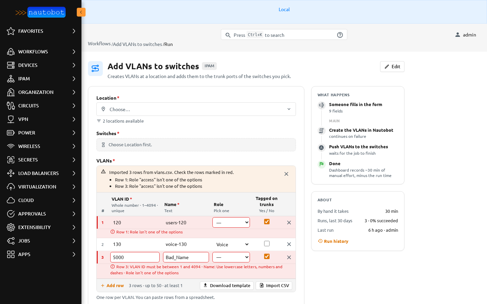

# Inputs

Inputs are the fields someone fills in on the launch form. Open **Inputs** in the builder and choose **Add input**.

## Field types

| Type | Shown as | Value passed to steps |
| --- | --- | --- |
| Text | A text box. | The text. |
| Whole number | A number box that rejects decimals. Optional minimum and maximum. | A number. |
| Yes/no | A switch. | `true` or `false`. |
| Pick one | Option buttons or a list. | The option's value. |
| Pick many | A list where several options can be ticked. | A list of values. |
| Nautobot object | A searchable picker, for example a device. | The object. Use `.id`, `.name` and so on in steps. |
| Several Nautobot objects | A searchable picker that takes several. | A list of objects. |
| List of text | One line per item. Optional at least / at most. | A list of text. |
| Table | An editable grid with columns you define. | A list of rows. |

Each input row has a drag grip, a type icon, tags that sum up its settings, **Move up**, **Move down**, **Duplicate**, **Delete**, and a chevron that opens it. **Delete** can be undone from the notice that appears.

## Common settings

- **Label**: shown beside the field.
- **Required**: the form can't be sent without it.
- **Help text**: shown under the field.
- **Placeholder**: a grey hint inside an empty field.
- **Default**: filled in when the form opens.
- **Validation rules**: a pattern the value must match, and the message people see when it doesn't.
- **Advanced · variable name**: how steps refer to the value, as `{{ inputs.<name> }}`. It is made from the label and can't change after the first publish.

## Nautobot object fields

Choose **Which kind of object?**, for example *Device*. **Only offer devices where…** narrows the list with WHERE and AND rows: a field, a plain-word operator such as *is* or *contains*, and either a fixed value or a value from another input. The builder shows how many objects match right now, for example *6 devices match with Location = AMS01*.

When a filter uses another input, the field waits for it. On the launch form it says *Choose Location first.* until that field has a value. **Switch to advanced (Jinja)** is there for filters the rows can't express.

## Show only when

**Show only when** hides a field until another field has a certain value, for example *Confirm power cycle* only when *Reboot type* is *Hard power cycle*. A hidden field is not sent with the form.

## Tables and CSV import

A table collects rows, for example a list of VLANs. In the builder, add columns. Each column has a key, a label, a type (text, whole number, decimal number, yes/no, or pick one), and optional *required*, *unique*, minimum, maximum, and pattern rules. **At least** and **At most** set the number of rows.

On the launch form the table is an editable grid:

- **Add row** adds an empty row. The **×** at the end of a row removes it.
- **Download template** saves a CSV file whose headings match the columns.
- **Import CSV** reads a CSV file into the grid. You can also paste rows copied from a spreadsheet.
- If the table already has rows, import asks whether to **Replace** them or **Add** to them.

After an import, a notice says how many rows came in and lists the rows to fix. Each problem is shown under its row and the cell is outlined in red.

CSV rules:

- Headings are matched to a column's key first, then its label.
- A pick-one column accepts the option's value or its label.
- A yes/no column accepts `true`/`false`, `yes`/`no`, `on`/`off` and `1`/`0`.
- Rows beyond **At most** are skipped, and the notice says so. Files over 2 MB are refused.
- A cell that starts with `=`, `+`, `-` or `@` is flagged, because spreadsheet apps would treat it as a formula. A negative number in a number column is fine.
- The file is read in your browser. It is not uploaded or stored. Only the rows in the grid are sent with the form.

To hide **Import CSV** and **Download template** for one table, turn off **Allow CSV import** for that input.

## Referring to inputs

Steps use inputs as `{{ inputs.<name> }}`, for example `{{ inputs.device.name }}`, `{{ inputs.change_ticket }}`, or `{{ inputs.vlans }}` for a whole table. The [steps page](steps.md#parameters) explains how to wire them without typing any of this.
