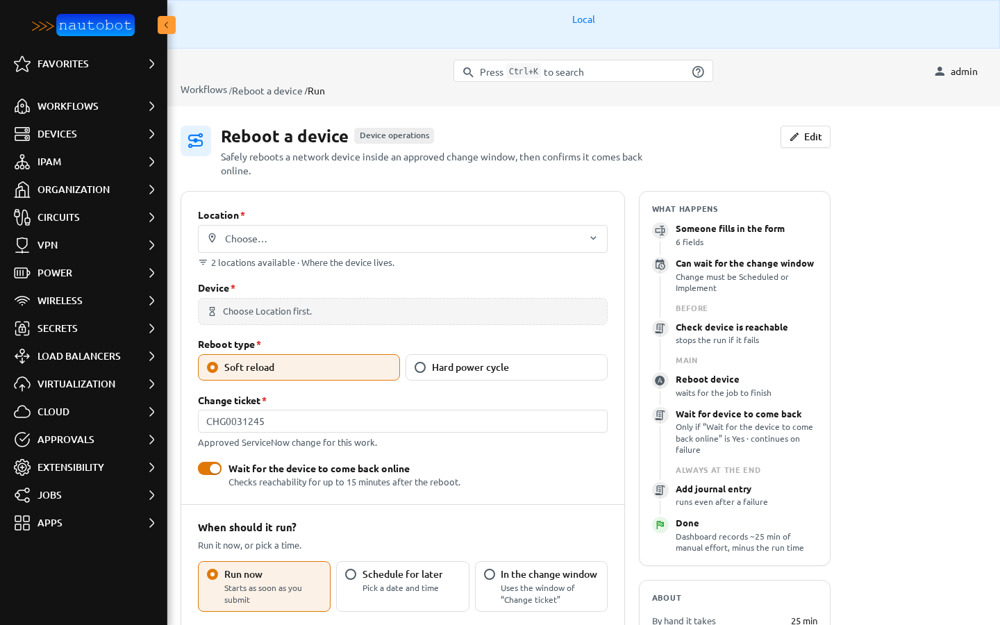
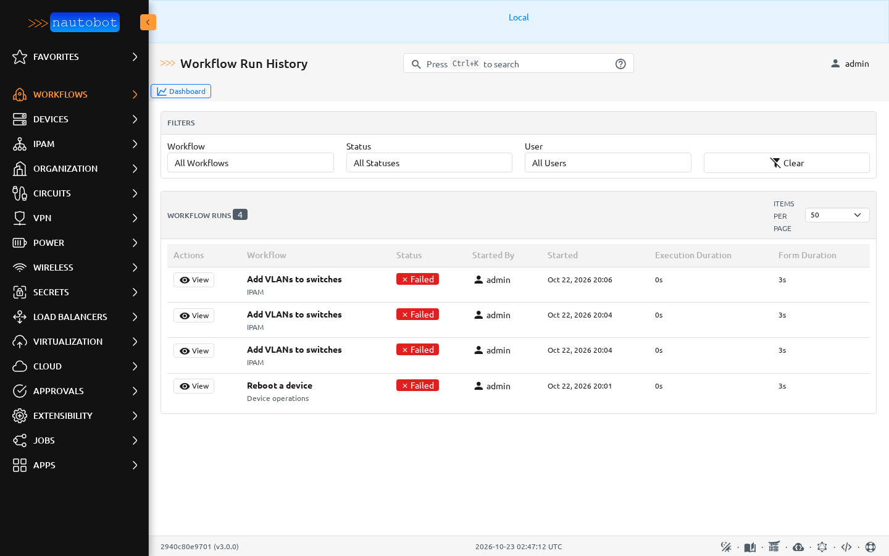
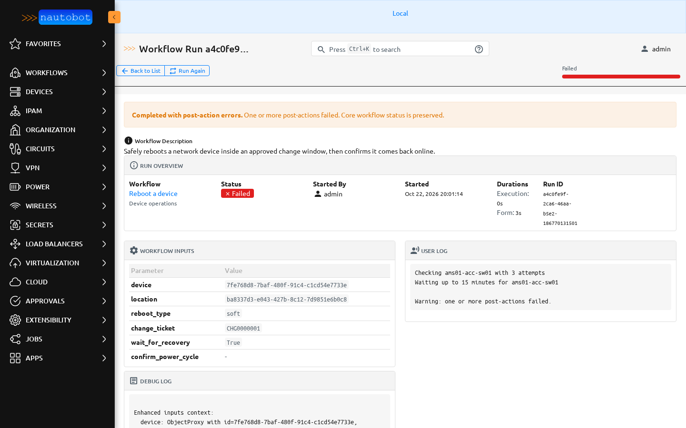

# Running a workflow

Open **Workflows** and choose **Run** on a row. People need permission to view the workflow and to add workflow runs. See [Permissions](permissions.md).

## The launch page

- The header shows the workflow's name, category and description. People who can edit it also see **Edit**.
- The form has the workflow's [inputs](inputs.md). Required fields are marked with a red asterisk. Help text sits under each field. A field that depends on another one says so, for example *Choose Location first.*, and object pickers say how many objects are available.
- **What happens** on the right lists the steps in the order they run, with notes such as *waits for the job to finish* or *Only if “Wait for the device to come back online” is Yes*.
- **About** shows how long the job takes by hand, how many runs there were in the last 30 days and how many succeeded, the last run, and a link to **Run history**.

Problems are shown on the field as you go. The form can't be sent until required fields are filled in and every value passes its checks. The same checks run again on the server.

## When should it run?

- **Run now** starts as soon as you submit.
- **Schedule for later** asks for a date and time.
- **In the change window** appears when the workflow is tied to ServiceNow. The run is booked for the window of the change ticket you entered and only runs if the change is approved and in an allowed state. See [Schedule and approval](schedule_approval.md).

If the workflow needs approval, the run waits as **Pending Approval** until someone approves it in **Approvals**.

For a scheduled run, the **Before** steps run once when the run is booked. If one fails, the run isn't booked.

## Tables and CSV

A table input is an editable grid with **Add row**, **Download template** and **Import CSV**. See [Tables and CSV import](inputs.md#tables-and-csv-import).

## Run history and run details

**Workflows → Run History** lists runs with their status, who started them, when, and how long they took. Filter by workflow, status and user.

A run's page shows its status, the inputs it got, each step's result, the run's own log and the detailed log. While a run is going, the page shows progress, AWX job completion and elapsed time.

| Status | Meaning |
| --- | --- |
| Scheduled | Booked for later. |
| Pending Approval | Waiting for an approver. |
| Pending | Queued for a worker. |
| Running | Running now. |
| Success | Everything required succeeded. |
| Failed | A required step failed. |
| Partial | Some steps succeeded and some failed. |
| Canceled | Canceled before it started. |

**Cancel Run** stops a run that is still **Scheduled** or **Pending Approval**. A running workflow can't be interrupted. See the [FAQ](faq.md).
