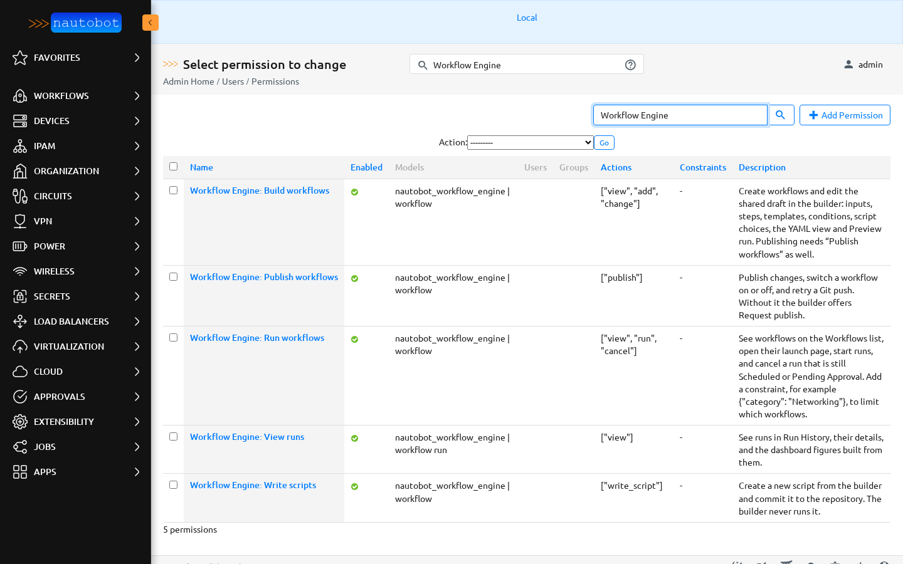

# Permissions

Workflow Engine uses Nautobot's object permissions. A constraint, for example on category, limits which workflows or runs a person gets the permission for.

## Ready-made permissions

The app creates these permissions when it is installed or upgraded, under **Admin → Users → Permissions** (`/admin/users/objectpermission/`). They are not given to anyone. An admin only has to open one, add users or groups, and optionally add a constraint.

| Permission | Object type | Actions |
| --- | --- | --- |
| Workflow Engine: Run workflows | workflow | view, run, cancel |
| Workflow Engine: View runs | workflow run | view |
| Workflow Engine: Build workflows | workflow | view, add, change |
| Workflow Engine: Publish workflows | workflow | publish |
| Workflow Engine: Write scripts | workflow | write_script |

Edit them freely: an upgrade never changes or reassigns a permission that already exists with that name. If you delete one, the next upgrade creates it again, unassigned; rename it instead if you want it gone for good. To scope access, for example one team per category, copy a permission and add a constraint to the copy.

Approving runs is not a Workflow Engine permission. Who approves a run is set in Nautobot's own approval workflow definitions (**Approvals → Workflow Definitions**): the approver group on each stage. See [Schedule and approval](schedule_approval.md).

Earlier builds also created **Workflow Engine: Author templates and scripts**, **Workflow Engine: Approve runs**, **Workflow Engine: View workflows** and **Workflow Engine: Cancel runs**. Upgrading deletes each one if nobody changed or assigned it. If one was assigned to someone or edited, it stays where it is and the upgrade logs a warning; delete it when you're ready. A kept **View workflows** or **Cancel runs** still works as before.

Upgrading also brings an unchanged **Run workflows** up to date: it moves to *Workflow* with view, run and cancel, and keeps its users and groups. It is left alone, with a warning, if an admin changed it or if someone on it also has a constrained view of workflows, because the new entry would let them see and run every workflow. Give those people a constrained copy of the new **Run workflows** instead.

## Running workflows

| Permission | What it allows |
| --- | --- |
| `nautobot_workflow_engine.view_workflow` | See published workflows on the Workflows list and open their launch page. Part of **Run workflows** and **Build workflows**. |
| `nautobot_workflow_engine.run_workflow` | Start a run of this workflow. Additional action `run`, part of **Run workflows**. |
| `nautobot_workflow_engine.cancel_workflow` | Cancel a run of this workflow that is still Scheduled or Pending Approval, whoever started it. Additional action `cancel`, part of **Run workflows**. |
| `nautobot_workflow_engine.view_workflowrun` | See runs in Run History, their details, and the dashboard figures built from them. This is **View runs**. |

**Run workflows** is one permission on *Workflow*, so a single constraint such as `{"category": "Networking"}` decides which workflows a person sees, runs and cancels. It can't also cover *Workflow run*: Nautobot gives every action of a permission to every object type it lists, so that would also hand out building and every run's details.

The Cancel button is on the run's page, so cancelling also needs **View runs** for that run.

Permissions you made yourself with the older actions keep working: `add_workflowrun` together with `view_workflow` starts runs, and `change_workflowrun` cancels them.

## Building workflows

| Permission | Shown as | What it allows |
| --- | --- | --- |
| `nautobot_workflow_engine.add_workflow` | Can add | Create a workflow. Its first edits are a shared draft. |
| `nautobot_workflow_engine.change_workflow` | Can change | Edit the shared draft, including templates, conditions, a step's script and the YAML view. Discard the draft, restore a version into it, and use **Preview run**. Shows **Edit** on the launch page. |
| `nautobot_workflow_engine.publish_workflow` | Publish workflows | **Publish changes**, turn **Enabled** on or off, and **Retry** a Git push. Without it the button is **Request publish**. |
| `nautobot_workflow_engine.write_script_workflow` | Write scripts | Use **Create script** in [New script…](placeholder_scripts.md) and type the script's code. |

The last two are extra actions on the *Workflow* object type. The ready-made permissions above already carry them. To make your own, create an object permission for **nautobot_workflow_engine | workflow**, and type the action name in **Additional actions**: `publish` or `write_script`.

### Build workflows covers templates and the YAML view

Everything in the builder's draft is part of **Build workflows**: labels and help text, templates and filters, conditions, which script a step uses, and the YAML view. Templates always render in a sandbox, and nothing goes live until someone with **Publish workflows** publishes it. Writing the code of a new script is separate: that is **Write scripts**.

### Write scripts

Without **Write scripts**, the **New script…** panel shows the generated file read-only with **Copy code**, so the person can hand it to an admin. With it, the person can type the script's code and commit it to the repository with **Create script**. Either way the builder never runs the code. The new file is a starter that prints the values it gets; it runs like any other script once a workflow step uses it, so grant this permission only to people whose code you are happy to have in the repository.

### Preview run

**Preview run** uses the change permission. It never runs a script, calls AWX, or records a run, a scheduled job or an object change.

## Repositories are not a permission

Publishing to Git also needs a repository that is set up for it: **workflows** ticked under **Provides**, and a secrets group with an HTTP(S) token. That is a property of the repository, not a second approval. See [Getting a repository ready](publishing.md#getting-a-repository-ready).

**Enabled** is Nautobot state. It applies immediately after the first publish and doesn't make a Git commit. A YAML `enabled:` value only sets the switch the first time the file is imported.

## Examples

| Person | Grant |
| --- | --- |
| Operator who runs any workflow | **Run workflows** and **View runs**. |
| Operator who runs Networking workflows | A copy of **Run workflows** constrained to `{"category": "Networking"}`, and a copy of **View runs** constrained to `{"workflow__category": "Networking"}`. |
| Engineer who builds workflows | The operator set, plus **Build workflows** and **Publish workflows**. |
| Automation engineer | The engineer set, plus **Write scripts**. |
| Approver | No Workflow Engine permission. Add them to the approver group on the workflow's stage in **Approvals → Workflow Definitions**. |
| Manager who reads reports | A copy of **View runs** constrained to their team's category. |

More examples with constraints are in [Install and configure](../admin/install.md#permissions).
