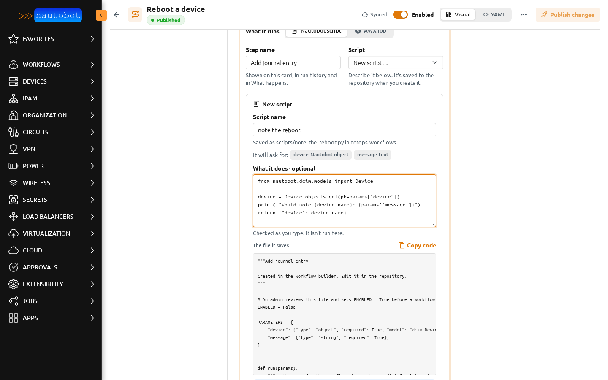
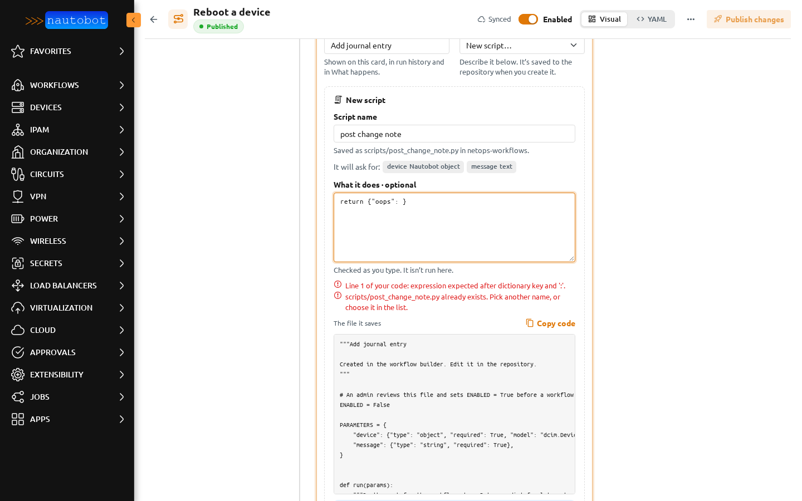
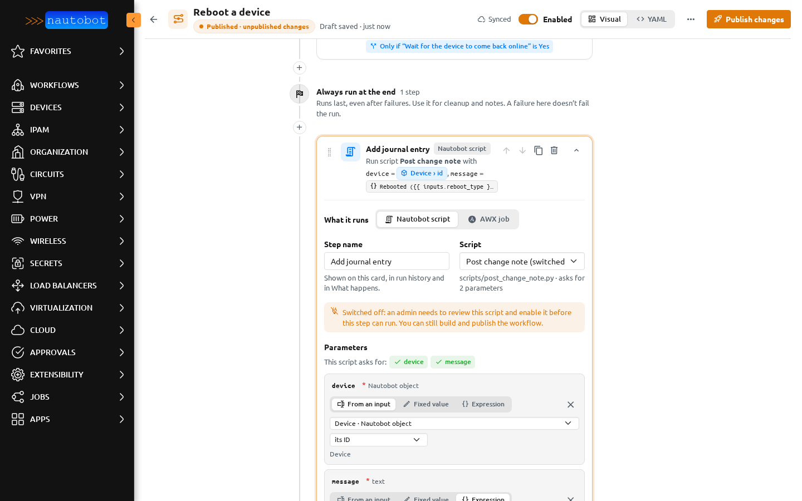
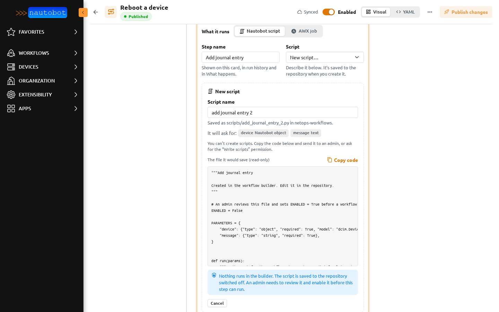

# New scripts from the builder

A workflow step of type **Nautobot script** runs a Python file from the workflow's repository. When the script you need doesn't exist yet, the builder can write a starting point for it, so the workflow can be designed now and the code reviewed later.

## Create a script

1. Open a step, set **What it runs** to **Nautobot script**, and pick **New script…** at the end of the **Script** list.
2. Give it a **Script name**. The builder shows where it will be saved, for example *scripts/post_change_note.py in netops-workflows*.
3. The parameters come from the step: each parameter you have wired is listed under **It will ask for**, with its type taken from the input it is wired to.
4. Optionally, write **What it does**: the body of the script. It is checked as you type.
5. Check **The file it saves**, then choose **Create script**.



The file is committed to the workflow's repository, in its scripts folder, as you. It appears in the **Script** list straight away. An existing file is never overwritten: pick another name if the builder says it already exists.

## What gets checked

The code is only read, never run. The builder checks that it is valid Python and that the file has nothing at the top level except its description, `ENABLED`, `PARAMETERS` and `def run(params)`. A problem is shown with the line of your own code it is on.



The builder never imports, evaluates or runs a script, not when creating it, not in the preview, and not in [Preview run](preview_run.md).

## The file

```python
"""Post change note

Created in the workflow builder. Edit it in the repository.
"""

# An admin reviews this file and sets ENABLED = True before a workflow step can run it.
ENABLED = False

PARAMETERS = {
    "device": {"type": "object", "required": True, "model": "dcim.Device"},
    "message": {"type": "string", "required": True},
}


def run(params):
    """Do the work for the workflow step. Return a dict for later steps to read."""
    return {"note": params["message"]}
```

This is the same format as the other scripts in the repository: a description, `PARAMETERS`, and `run(params)` returning a result for later steps. Further changes to the code are made in the repository, through your normal review.

## Switched off until an admin enables it

Every created script starts with `ENABLED = False`. While it is off:

- the **Script** list shows it as *(switched off)*;
- the step shows a note that an admin needs to review the script and switch it on;
- [Preview run](preview_run.md) marks the step;
- a real run stops at that step with: *This script is switched off. An admin needs to review scripts/&lt;name&gt;.py and set ENABLED = True before this step can run.*



To switch it on, an admin reviews the file in the repository, changes `ENABLED = False` to `ENABLED = True`, commits, and syncs the repository. The runner reads the flag without importing the file. Scripts that don't have an `ENABLED` line, such as existing ones, run as before.

## Permission

Creating a script needs the **Write scripts** permission: the action `write_script` on the *Workflow* object type (`nautobot_workflow_engine.write_script_workflow`). See [Permissions](permissions.md).

Without it, the panel still builds the file from the step, but shows it as **The file it would save (read-only)** with **Copy code**, and says: *You need the “Write scripts” permission to create scripts. Copy the code and send it to an admin instead.*



The repository must be ready for publishing, the same as for publishing a workflow. See [Getting a repository ready](publishing.md#getting-a-repository-ready).
