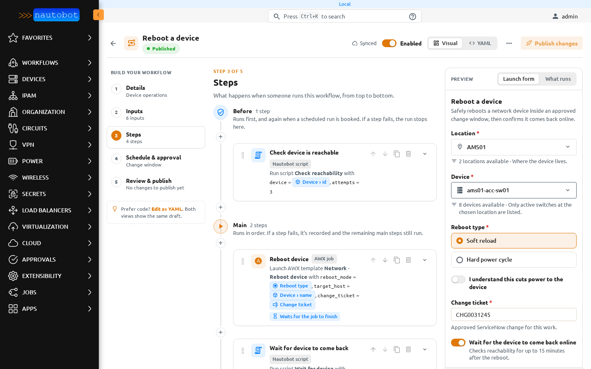
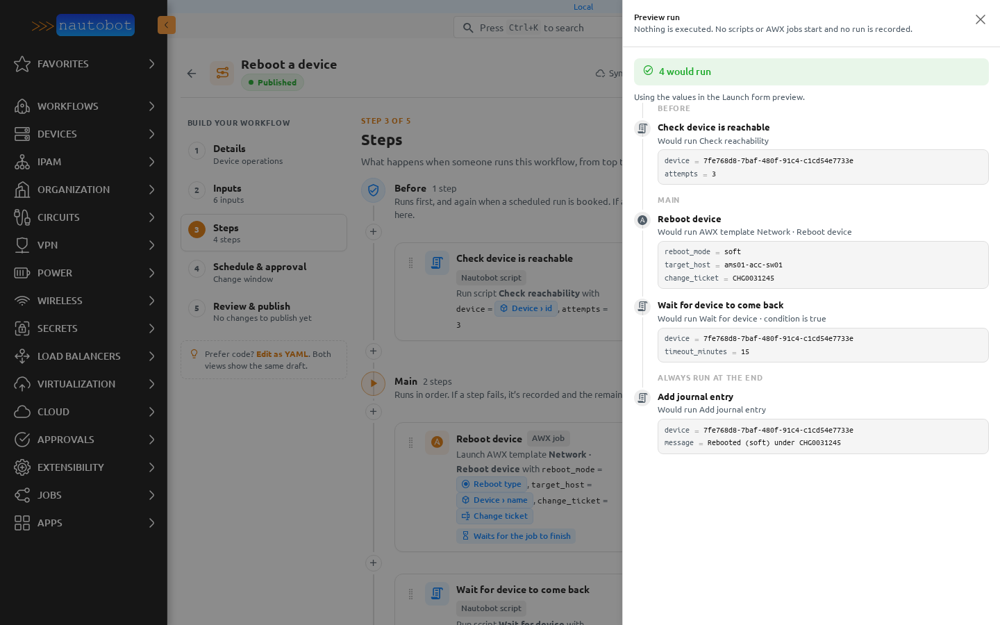

# Preview run

**Preview run** shows what the draft would do with the values in the Launch form preview. It never executes anything: no script starts, AWX is not called, no run is recorded, no job is booked and no object changes.

Open it from **Review & publish**, from **What runs** in the preview column, or from the **⋯** menu.

## Fill in the Launch form preview first

Preview run uses the values typed into the **Launch form** preview on the right of the builder. Fill in the required fields there first.

If a required value is missing or invalid, Preview run lists those fields first and doesn't show any steps.

## What it shows

For each phase and step, Preview run:

1. says whether the step would run and why, for example that its condition is true or false;
2. shows the parameters the step would get, rendered with your values;
3. shows a rendering error on the step it belongs to.

A count at the top sums it up, for example *4 would run*. A step that uses a script an admin hasn't switched on yet is marked, because it would stop in a real run. See [New scripts from the builder](placeholder_scripts.md#switched-off-until-an-admin-enables-it).

When a condition depends on an earlier step's output, Preview run says so. The output only exists in a real run.

## Permission

Preview run needs the permission to change workflows. Nothing it does needs more, because nothing runs.
