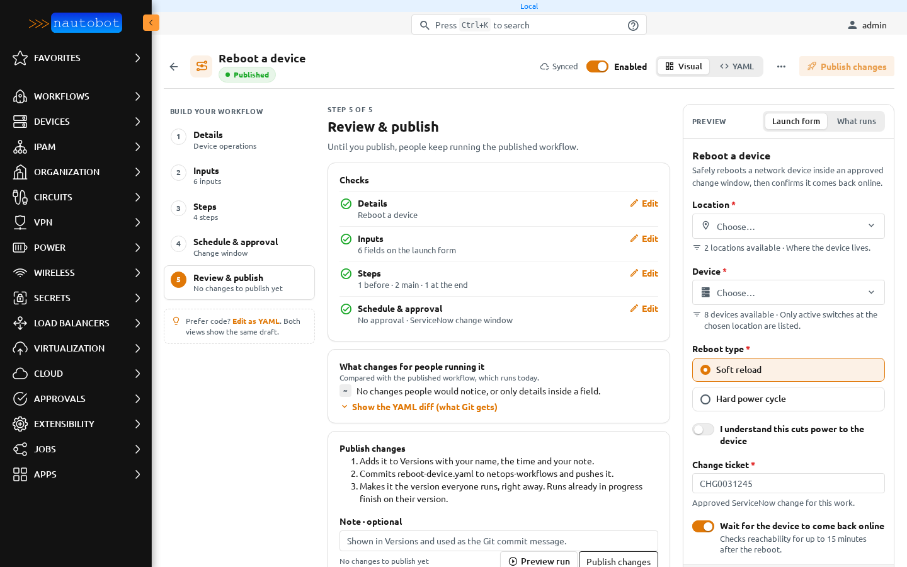
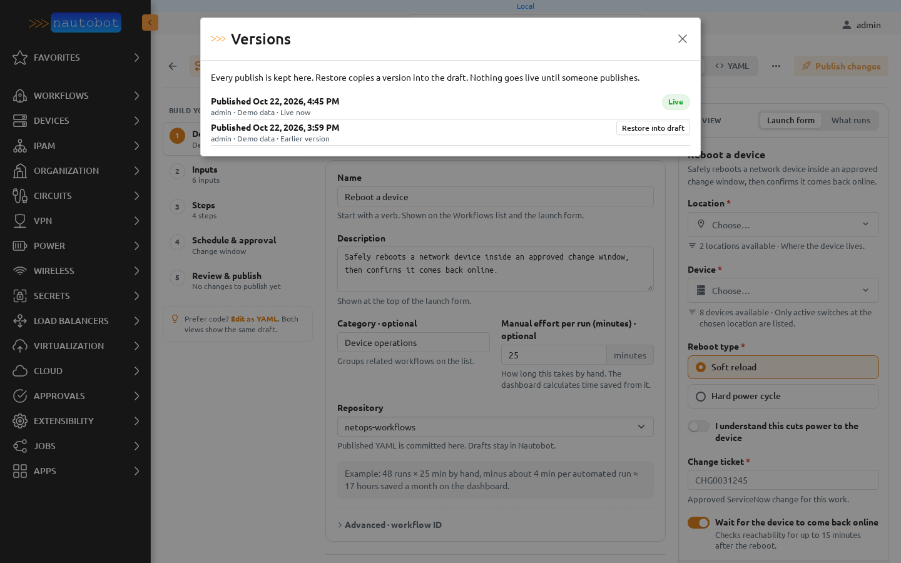
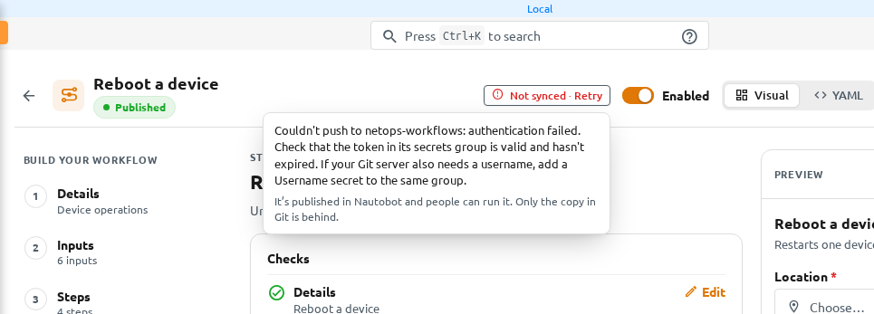
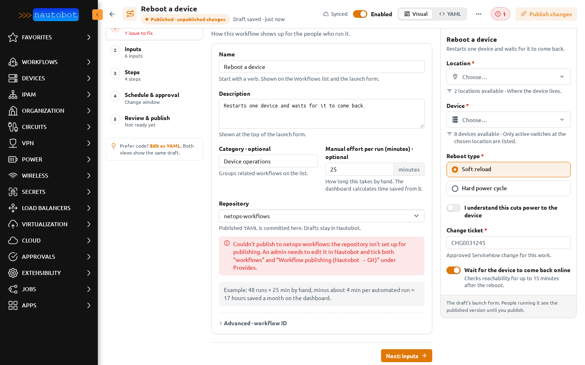
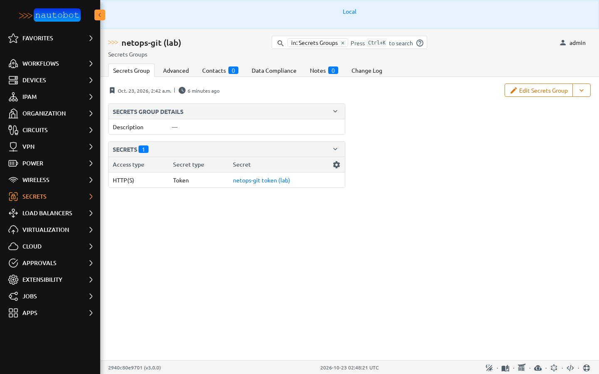

# Publishing and versions

A workflow has one shared draft and one published version. People running the workflow always get the published version. Publishing makes the draft the new published version and writes it to the workflow's Git repository.

## Review & publish

**Review & publish** shows:

- **Checks**: one line per builder step, with **Edit** to jump back. A step with issues says what is wrong.
- **What changes for people running it**: the difference from the published version in plain words. **Show the YAML diff (what Git gets)** opens the exact change.
- **Publish changes**: what will happen, in order:
    1. the version is added to **Versions** with your name, the time and your note;
    2. the workflow's file is committed to its repository and pushed;
    3. it becomes the version everyone runs, right away. Runs already in progress finish on the version they started with.
- **Note**: optional. It is shown in Versions and used as the Git commit message.

The button reads **Publish** for a workflow that was never published and **Publish changes** after that. It is on only when the draft differs from the published version and has no issues.

Without the *Publish workflows* permission the panel is **Request publish**: your draft keeps saving, and **Copy link** gives you a link to send to someone who can publish.

## Versions

Open **Versions** from the **⋯** menu.

Every publish is kept. Each entry shows when it was published, by whom, and its note. **Live** marks the version people run now. **Restore into draft** copies an older version into the draft. Nothing goes live until someone publishes.

Drafts are named by what they are: **Current draft · started …** for the draft you are editing, and **Draft from …** for a draft that was discarded and never published.

**Discard draft…** in the **⋯** menu throws away the draft's changes after asking. A workflow that was never published offers **Delete this draft…** instead.

## Git

The published workflow lives in Nautobot and in a file in its Git repository. The header shows how the two compare:

| Indicator | Meaning |
| --- | --- |
| **Not in Git yet** | Never published. |
| **Syncing…** | A publish is being pushed. The builder updates when it finishes. |
| **Synced** | Git has the published version. |
| **Not synced · Retry** | The push didn't work. Hover over or tab to it for the reason. The version is already live in Nautobot. **Retry** checks the repository again and pushes. Nautobot also retries on its own after 1, 5, 15 and then every 60 minutes. |

When someone publishes a change straight to Git while you edit, a banner says **Updated in Git by &lt;author&gt; at &lt;time&gt;**. Publishing is paused until you **Compare** or **Load their version**. Loading their version keeps your draft in Versions.

How the two-way sync decides which change wins is described in [Two-way Git sync](git_sync.md).

## Getting a repository ready

Before a workflow can be published to a repository, an admin sets that repository up once in Nautobot. If something is missing, the builder says what under **Repository** on **Details**, counts it as an issue, and keeps **Publish changes** off.

The repository needs three things:

1. **Provides** includes both **workflows** and **Workflow publishing (Nautobot → Git)**.

    

2. A **secrets group** with a secret of access type **HTTP(S)** and secret type **Token**. A token on its own is enough for GitHub and most servers. If your Git server also needs a username (some GitLab and Bitbucket setups do), add a second secret to the same group with access type **HTTP(S)** and secret type **Username**.

    

3. A remote URL that starts with `https://` (or `http://` on a lab server).

The token's account needs permission to push to the repository's branch. These are the same credentials Nautobot uses to sync the repository, and the same ones the Golden Config app uses for its repositories.

Step by step:

1. **Secrets → Secrets → Add**. Pick a provider that returns the token, for example *Environment Variable* with the variable set on the Nautobot server and every worker.
2. **Secrets → Secrets Groups → Add**. Under **Secrets**, add the token secret with access type **HTTP(S)** and secret type **Token**. Add the username secret too if your server needs one.
3. **Extensibility → Git Repositories**, edit the repository. Set **Secrets group**, tick **workflows** and **Workflow publishing (Nautobot → Git)** under **Provides**, and save.
4. **Sync** the repository once.
5. Reopen the workflow in the builder. The repository problem is gone and **Publish changes** is available.

## When publishing fails

Every failure is explained in one sentence that names the repository. The same sentence is shown in the builder, on hover over **Not synced · Retry**, and on the Workflows list. The full technical error goes to the Nautobot server log and the publish job's log, without the token.

| Message starts with | What to do |
| --- | --- |
| Couldn't publish to *repo*: the repository isn't set up for publishing | Tick both **workflows** and **Workflow publishing (Nautobot → Git)** under **Provides**, then sync the repository. |
| Couldn't push to *repo*: the repository has no token | Give the repository a secrets group with an HTTP(S) Token secret. |
| Couldn't push to *repo*: its secrets group “*group*” has no token | Add a secret with access type HTTP(S) and secret type Token to that group. |
| Couldn't push to *repo*: publishing needs an https:// repository address | Change the repository's remote URL to its https address. |
| Couldn't push to *repo*: authentication failed | The token is wrong or expired. Replace it. If the server needs a username, add an HTTP(S) Username secret. |
| Couldn't push to *repo*: the token in its secrets group couldn't be read | The secret's provider can't return a value, for example its environment variable isn't set on the server or worker. |
| Couldn't push to *repo*: the token can read the repository but can't push to it | Give the token's account write access. |
| Couldn't push to *repo*: the branch “*branch*” is protected | Allow the token's account to push to that branch, or point the repository at a branch it can push to. |
| Couldn't push to *repo*: the branch “*branch*” doesn't exist there | Create the branch, or change the repository's branch. |
| Couldn't push to *repo*: the repository wasn't found at its address | Check the remote URL, and that the token's account can see the repository. |
| Couldn't push to *repo*: couldn't reach the Git server | Check the address, DNS, proxy and firewall from the Nautobot worker. |
| Couldn't push to *repo*: others kept pushing to “*branch*” while this was publishing | Nothing. Someone else pushed at the same moment three times in a row. It tries again shortly. |
| Couldn't push to *repo*: another publish to it is still running | Wait. Only one publish per repository runs at a time. |
| Couldn't start publishing to *repo* | The background worker isn't taking jobs. Check that the Nautobot worker is running. It tries again shortly. |
| Couldn't push to *repo*: Git said “…” | Anything else. The quote is Git's own last line; the server log has the rest. |

After fixing the cause, press **Retry** in the builder, or wait for the automatic retry.

If someone pushes to the same branch while a publish is running, the publish fetches their commit, writes the file again on top of it, and pushes. It never force-pushes and never rebases.
