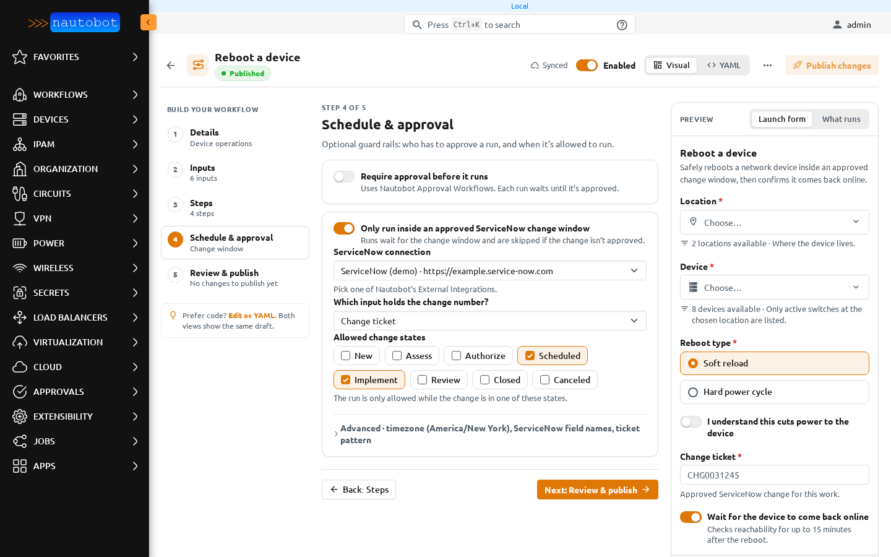

# Schedule and approval

**Schedule & approval** controls who has to approve a run and when it is allowed to run. Both are optional.

## Require approval before it runs

Turn on **Require approval before it runs** to send every run through Nautobot's Approval Workflows. This works on Nautobot 3.2 and later; on older versions the setting is kept and has no effect.

After the first publish, an admin opens **Approvals → Workflow Definitions**, finds *Workflow Engine: &lt;workflow ID&gt;*, and adds at least one stage (approver group and minimum approvers). Until it has a stage, runs stay **Pending Approval**. Approvers use **Approvals → Approval Dashboard**. More detail is in the [YAML reference](app_use_cases.md#requiring-nautobot-approval-32).

## Only run inside an approved ServiceNow change window

Turn on **Only run inside an approved ServiceNow change window** to tie runs to a change ticket.

- **ServiceNow connection**: one of Nautobot's External Integrations. See [Integrations](external_interactions.md#servicenow-change-windows).
- **Which input holds the change number?**: one of the workflow's text inputs.
- **Allowed change states**: the run is only allowed while the change is in one of these states, for example *Scheduled* or *Implement*.
- **Advanced**: the change window timezone, the ServiceNow fields to read the start and end from, and the ticket pattern. **Change window timezone** is a searchable list with common timezones first and the current UTC offset beside each. It is used for times ServiceNow returns without a timezone, and defaults to UTC.

Runs wait for the change window and are skipped if the change isn't approved. An admin must enable and schedule the *Sync ServiceNow Scheduled Workflows* job so booked runs follow changes to the ticket. See [Keeping scheduled runs in sync](external_interactions.md#keeping-scheduled-runs-in-sync-with-servicenow).

## On the launch page

The settings here decide what **When should it run?** offers on the launch form: **Run now**, **Schedule for later**, and, when the change window is on, **In the change window**. See [Running a workflow](launch.md#when-should-it-run).
