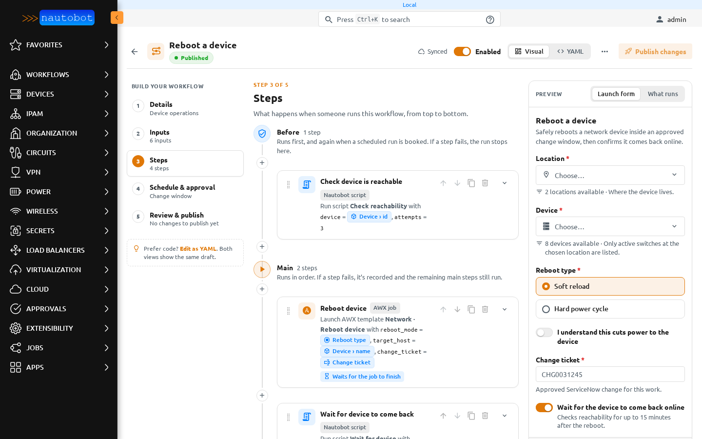
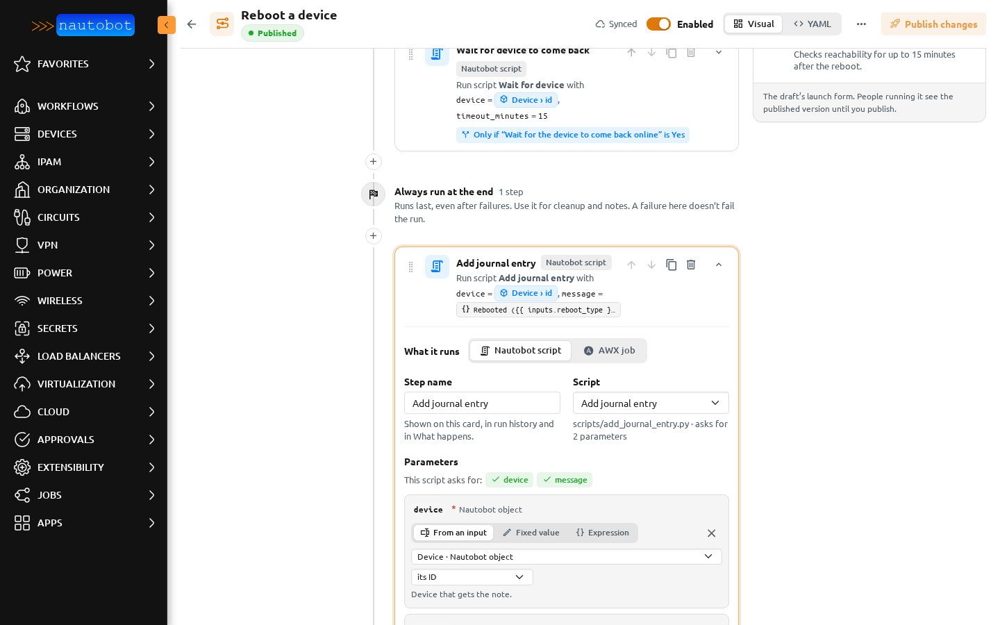

# Steps

Steps are what a workflow does. Open **Steps** in the builder. They are drawn on one timeline, in the order they run.

## Phases

| Phase | When it runs | If a step fails |
| --- | --- | --- |
| **Before** | First. For a scheduled run, also once when the run is booked. | The run stops. Nothing else runs. |
| **Main** | In order, after Before. | The failure is recorded and the remaining main steps still run. |
| **Always run at the end** | Last, even after failures. Use it for clean-up and notes. | Recorded, but it doesn't fail the run. |

A **+** between two steps adds a step at that point. Each step card has **Move up**, **Move down**, **Duplicate** and **Delete** in its header. **Delete** can be undone from the notice that appears.

## Step settings

- **What it runs**: **Nautobot script** or **AWX job**. Switching keeps the name, condition and phase. If the switch would drop settings, the builder asks first and offers **Undo** afterwards.
- **Step name**: shown on the card, in run history and in **What runs**.
- **Script** (Nautobot script): pick one of the scripts in the workflow's repository. The last option, **New script…**, writes a new one. See [New scripts from the builder](placeholder_scripts.md).
- **Job template** (AWX job): the AWX job template, and **Wait for the job to finish**.
- **Condition**: see [Conditions](conditions.md).
- **Advanced · step key**: how later steps refer to this step's result, as `{{ results.<key> }}`. It is made from the name until you change it, and it can't change after the first publish, because run history and later steps rely on it.

## Parameters

**This script asks for** lists what the script needs, read from the script file. The builder never runs the script to find out. Each parameter has three ways to get its value:

- **From an input**: pick a launch-form input. For a Nautobot object, also pick what to pass, such as its ID or its name.
- **Fixed value**: type the value. It is saved as typed.
- **Expression**: a Jinja template, for example `Rebooted ({{ inputs.reboot_type }}) under {{ inputs.change_ticket }}`.

The card sums up each parameter as a chip, for example *device = Device › id*. **Add parameter** adds one the script doesn't list. AWX steps have **Extra variables** that work the same way.

### Writing expressions

The expression editor helps as you type:

- Type `{{` or press Ctrl+Space to get a list of inputs and earlier step results.
- A typing mistake is named in plain words, for example *There's no input called “devcie”. Did you mean “device”?*, with **Fix it**.
- **Preview** shows the result with the values from the Launch form preview, or sample values when the preview is empty.

The common forms are:

| You want | Write |
| --- | --- |
| An input's value | `{{ inputs.change_ticket }}` |
| A field of a picked object | `{{ inputs.device.name }}` |
| An earlier step's output | `{{ results.check_reachable.return_value.reachable }}` |
| Text with values in it | `Rebooted {{ inputs.device.name }} under {{ inputs.change_ticket }}` |

A single reference such as `{{ inputs.device.id }}` is something anyone with edit rights can set. Anything more, such as filters or calculations, needs the *Author templates and scripts* permission. Templates run in a sandbox: they can read values but can't reach private attributes or change data.

## Results

Each step leaves a result for later steps and for run history:

- `status`: `success`, `failed` or `skipped`.
- `return_value`: what the script returned, or the AWX job's outcome.
- `error`: why it failed, when it failed.

A condition can use any of these. See [Conditions](conditions.md).
